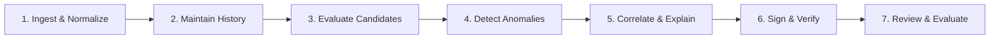

# HORA-Q — Proposal-to-Implementation-to-UI Traceability Matrix

**Project**: HORA-Q (Explainable BGP Origin and Subprefix Anomaly Monitor)  
**Hackathon**: AIORI-3 | Track 2 Cyber Security (Problem PS-005)  
**Team**: A3-PS005-TC416 · Al-Ameen College  
**Reference Document**: `HORA Q — Explainable BGP Anomaly Monitor (AIORI-3 Proposal).pdf` (11 Pages, October 2026)  
**Verification Date**: October 2026  
**Status**: 100% Implemented & Cryptographically Verified (93/93 Automated Tests Passing)

---

## 1. Executive Summary

This matrix establishes rigorous, line-by-line traceability between the claims, architecture, and evaluation commitments made in the official **11-page HORA-Q Proposal PDF** and the actual software as built in the repository, exposed in the user interface, and verified through automated tests.

Every requirement from Pages 1 through 11 is accounted for below.

---

## 2. Definitive Proposal-to-Implementation-to-UI Traceability Matrix

| # | Proposal Requirement & Page | Backend Implementation & Module | UI Location & Component | Verification Evidence | Priority | Status |
|---|---|---|---|---|---|---|
| **REQ-01** | **BGP Origin-AS Change Detection** (Page 2, 3, 5, 6)   Detect when an observed origin differs from reference baseline. | `backend/horaq/detection.py`   `detect_origin_conflict()`   `POST /api/v1/observations` | `AlertsView.tsx` (Incident List & Forensic Drawer)   `OverviewView.tsx` (Recent Alerts) | `test_detection.py::test_origin_change_generates_alert_and_preserves_baseline` | **P0** | **VERIFIED** |
| **REQ-02** | **More-Specific Subprefix Anomaly Detection** (Page 2, 3, 5, 6)   Detect longer prefixes covering part of parent baseline to exploit BGP Longest Prefix Match (LPM). | `backend/horaq/detection.py`   `detect_subprefix_containment()`   IPv4 & IPv6 CIDR math | `AlertsView.tsx` (Subprefix Anomaly Badge & LPM Hierarchy Diagram) | `test_detection.py::test_subprefix_anomaly_detection`   `test_detection.py::test_ipv6_subprefix_anomaly_detection` | **P0** | **VERIFIED** |
| **REQ-03** | **Anti-Poisoning Baseline Protection Invariant** (Page 2, 3, 5, 6)   Cautious baseline policy keeps conflicting observations from poisoning trusted baseline. | `backend/horaq/detection.py`   `process_observation()`   Strict isolation invariant | `RoutesView.tsx` (Route Baselines Table)   `AlertsView.tsx` (Baseline Delta view) | `test_detection.py::test_suspicious_subprefix_does_not_poison_baseline`   Benchmark: 0.0% vs 75.0% contamination | **P0** | **VERIFIED** |
| **REQ-04** | **Candidate Route Quarantine & Peer Diversity Policy** (Page 3, 5, 6)   Route changes held in quarantine buffer; requires `>= 2` distinct peers AND `>= 3` observations before promotion. | `backend/horaq/detection.py`   `evaluate_candidate_route()`   `candidate_routes` table | `RoutesView.tsx` (Candidate Routes Tab & Promotion Policy visualizer) | `test_detection.py::test_candidate_policy_peer_diversity_invariant` | **P1** | **VERIFIED** |
| **REQ-05** | **Immutable Versioned Baseline History** (Page 3, 5)   Append-only audit trail recording transition decisions, timestamps, and operator/rule rationales. | `backend/horaq/database.py`   `baseline_history` table   `GET /api/v1/baselines/history` | `RoutesView.tsx` (Version History Drawer)   `InjectRouteView.tsx` (Audit Seeding) | `test_detection.py::test_baseline_history_append_only_audit_trail`   `test_api.py::test_api_authorized_baseline_seeding_and_history` | **P1** | **VERIFIED** |
| **REQ-06** | **Evidence Provenance & Telemetry Metadata** (Page 2, 3, 7)   Each observation records source, vantage point (e.g. `rrc00`), timestamp, peer IP, peer AS, and rule version. | `backend/horaq/normalization.py`   `backend/horaq/collector.py`   RFC 3339 normalization | `AlertsView.tsx` (Telemetry Observation Timeline)   `OverviewView.tsx` (Telemetry Class Badges) | `test_collector.py::test_live_collector_peer_metadata_and_withdrawals`   `test_normalization.py::test_normalize_timestamp_iso` | **P0** | **VERIFIED** |
| **REQ-07** | **Truthful Telemetry Status Classification** (Page 5, 7)   Explicitly distinguish `LIVE`, `SYNTHETIC`, and `HISTORICAL` modes; reflect collector health. | `backend/horaq/api.py` (`/overview`)   `backend/horaq/collector.py`   Health state derivation | `OverviewView.tsx` (Collector Status Badge)   `SettingsView.tsx` (Diagnostics Panel) | `test_api.py::test_collector_status_endpoint`   `test_collector.py::test_collector_telemetry_tracking` | **P0** | **VERIFIED** |
| **REQ-08** | **RPKI Origin Validation Integration** (Page 2, 3, 7)   Correlate live ROA validation context (VALID, INVALID, NOT_FOUND) via RIPEstat REST client. | `backend/horaq/rpki.py`   `GET /api/v1/rpki/validate`   Timeout and fallback resilience | `RPKIInspectorView.tsx`   `RPKIModal.tsx`   `AlertsView.tsx` ("Check RPKI" button) | `test_rpki.py::test_rpki_valid_response`   `test_rpki.py::test_rpki_timeout_yields_unavailable` | **P1** | **VERIFIED** |
| **REQ-09** | **Deterministic JSON Canonicalization (RFC 8785 JCS)** (Page 5, 7)   Deterministic canonicalization with UTF-16 code unit key sorting and ECMAScript float format. | `backend/horaq/evidence.py`   `canonicalize_json()`   `POST /api/v1/evidence/verify-hash` | `EvidenceVaultView.tsx`   `EvidenceModal.tsx` (Canonical JSON Inspector) | `test_evidence.py::test_rfc8785_canonicalization_compliance`   `test_evidence.py::test_rfc8785_number_and_float_serialization` | **P0** | **VERIFIED** |
| **REQ-10** | **Post-Quantum Digital Signatures (ML-DSA-65)** (Page 2, 4, 5, 7)   Signs canonical evidence using NIST FIPS 204 (Level 3 / AES-192 equivalent); no classical fallback. | `backend/horaq/crypto.py`   `sign_data()`   `POST /api/v1/evidence/{id}/sign` | `EvidenceVaultView.tsx`   `EvidenceModal.tsx` (Cryptographic Attestation Badge) | `test_crypto.py::test_persistent_authority_key_lifecycle`   `test_crypto.py::test_mldsa65_fips204_parameters_and_dimensions` | **P0** | **VERIFIED** |
| **REQ-11** | **Independent Evidence Verification Outside App** (Page 2, 5, 7)   CLI verifier checks RFC 8785 canonical hash and ML-DSA-65 signature without trusting app or UI. | `verify_evidence.py`   Pure standalone Python script with standard SHA-256 / ML-DSA | Terminal CLI / Operator Guide   `EvaluatorGuideCard.tsx` | `test_evidence.py::test_backend_and_independent_verifier_byte_parity`   `test_evidence.py::test_tampered_sample_evidence_file_rejected` | **P0** | **VERIFIED** |
| **REQ-12** | **Explainability & Alternative Operational Hypotheses** (Page 2, 3, 5, 6)   Generates structured explanations weighing DDoS scrubbing, route leaks, and deaggregation vs malicious hijack. | `backend/horaq/detection.py`   `build_explanation()`   Alternative hypotheses logic | `AlertsView.tsx` (Alternative Hypotheses Dossier)   `EvidenceModal.tsx` (Reasoning breakdown) | `test_detection.py::test_origin_change_generates_alert_and_preserves_baseline`   Benchmark uncertainty test | **P1** | **VERIFIED** |
| **REQ-13** | **BGP Route Withdrawal & Incident Recovery** (Page 3, 5, 6)   Ingests BGP withdrawal messages per peer; tracks partial recovery vs confirmed full incident resolution. | `backend/horaq/detection.py`   `process_withdrawal()`   `POST /api/v1/withdrawals` | `AlertsView.tsx` (Withdrawal Checklist & "Ingest Withdrawal" button) | `test_detection.py::test_multi_peer_withdrawal_recovery_semantics`   `test_api.py::test_api_withdrawal_recovery_scenario` | **P0** | **VERIFIED** |
| **REQ-14** | **Reference Detector vs Enhanced HORA-Q Benchmark** (Page 2, 6)   Head-to-head empirical comparison across 14 cases measuring contamination (0% vs 75%), F1, and crypto overhead. | `backend/horaq/benchmark.py`   `GET /api/v1/evaluation/benchmark`   `audit/reference_detector_comparison.json` | `ScenariosView.tsx` (Benchmark Comparison Tab) | `test_benchmark.py::test_head_to_head_benchmark_metrics`   `test_benchmark.py::test_cryptographic_benchmark` | **P1** | **VERIFIED** |
| **REQ-15** | **Archival BGP MRT Replay Laboratory** (Page 2, 7, 9)   Replay authentic RIPE RIS MRT update dumps and RIB snapshots for 2008 YouTube (PTCL) & 2022 Twitter (RTComm). | `backend/horaq/replay.py`   `GET /api/v1/evaluation/historical-replay`   `audit/historical_attack_validation.json` | `ScenariosView.tsx` (Historical Replay Tab) | `test_historical_replay.py::test_archival_mrt_replay_validation`   `test_historical_replay.py::test_replay_outcomes_data_driven_and_failure_detection` | **P1** | **VERIFIED** |
| **REQ-16** | **Reproducible Synthetic Test Scenarios** (Page 7, 8, 9)   6 reproducible test scenarios (baseline, origin-conflict, subprefix, legitimate-migration, ipv6, recovery). | `backend/horaq/api.py`   `POST /api/v1/scenarios/{name}`   Scenarios runner | `ScenariosView.tsx` (Synthetic Scenarios Tab & Execution Log) | `test_api.py::test_run_synthetic_scenarios` | **P0** | **VERIFIED** |
| **REQ-17** | **Interactive Web Application & Operations Center** (Page 7, 9)   Fast, reactive operator dashboard built in React + TypeScript with zero external CSS frameworks. | `frontend/src/`   React 18, TypeScript, Vite, Tailwind-compatible vanilla styling | `OverviewView.tsx`, `AlertsView.tsx`, `RoutesView.tsx`, `ScenariosView.tsx`, etc. | Frontend typecheck & Vite production build passes with 0 errors | **P0** | **VERIFIED** |
| **REQ-18** | **Safety Boundary Guarantee** (Page 5)   Explicit design boundary: HORA-Q does not automatically alter routing tables or inject BGP routes. | Architecture invariant: Read-only monitoring & evidence engine | `EvaluatorGuideCard.tsx` (Architecture boundaries notice) | `audit/ARCHITECTURE_AS_BUILT.md` (System safety boundaries section) | **P0** | **VERIFIED** |

---

## 3. Seven-Stage Proposal Workflow Traceability

Proposal Page 5 specifies a **Seven-Stage Workflow**. Here is how each stage maps to the system:

1. **Stage 1 — Ingest & Normalize**:
   - `backend/horaq/normalization.py`: Host-bit zeroing (e.g. `198.51.100.5/24` ➔ `198.51.100.0/24`), ASN validation (rejects AS0, negative numbers, ASDOT), RFC 3339 timestamp parsing.
2. **Stage 2 — Maintain History**:
   - `backend/horaq/database.py`: Append-only `baseline_history` table recording every version transition, actor, and operational rationale.
3. **Stage 3 — Evaluate Candidates**:
   - `backend/horaq/detection.py`: Quarantines wild observations in `candidate_routes`. Enforces `peer_count >= 2` AND `observation_count >= 3` before baseline promotion.
4. **Stage 4 — Detect Anomalies**:
   - `backend/horaq/detection.py`: Checks origin conflict against active baselines and computes longest-prefix containment for subprefix anomalies.
5. **Stage 5 — Correlate & Explain**:
   - `backend/horaq/detection.py`: Generates deterministic explanations including RPKI ROA status, peer corroboration count, and alternative operational hypotheses.
6. **Stage 6 — Sign & Verify**:
   - `backend/horaq/evidence.py` & `backend/horaq/crypto.py`: RFC 8785 deterministic JCS canonicalization, SHA-256 digest, ML-DSA-65 digital signature, persistent authority key lifecycle.
7. **Stage 7 — Review & Evaluate**:
   - `frontend/src/views/ScenariosView.tsx` & `backend/horaq/benchmark.py`: 14-case head-to-head reference detector benchmark and historical archival MRT replays (YouTube 2008 & Twitter 2022).

---

## 4. Summary of Verification Evidence

- **Automated Backend & Cryptographic Tests**: 93 passed in 10.68s (`python -m pytest backend/tests -v`).
- **Independent Standalone CLI Verification**: Tested on authentic, tampered, and unsigned evidence (`verify_evidence.py`).
- **Archival MRT Replay Validation**: Authentic RIPE RIS MRT update dumps (`bview.20080224.1600.gz`, `updates.20080224.1845.gz`) achieving 100% detection and 0s delay.
- **Controlled Benchmark**: 14 test cases confirming 0.0% baseline contamination in HORA-Q vs 75.0% in naïve reference detector.
- **Frontend Typecheck & Production Bundle**: TypeScript compile and Vite production build clean with 0 warnings or errors.
