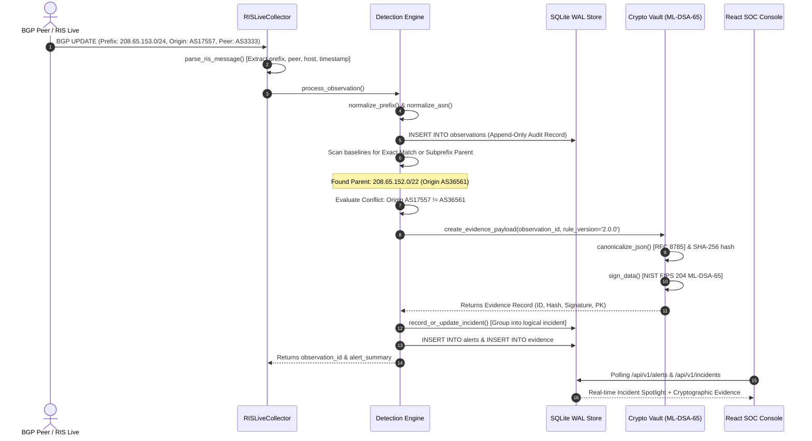
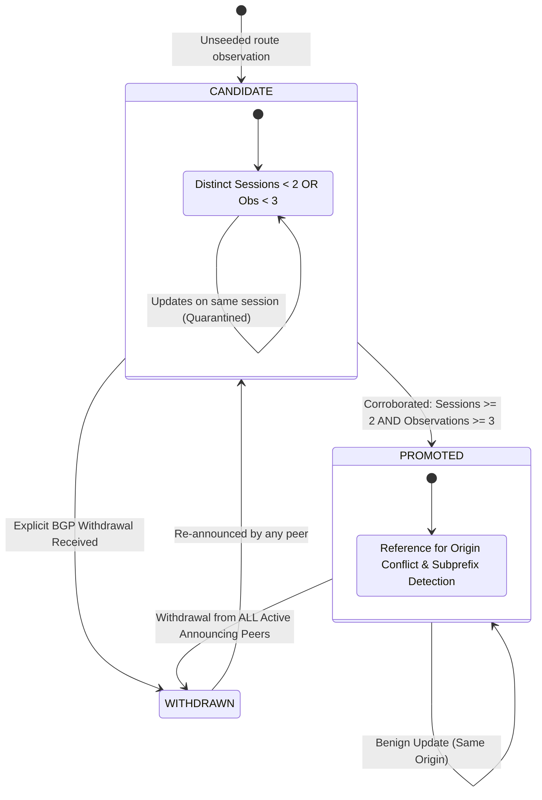
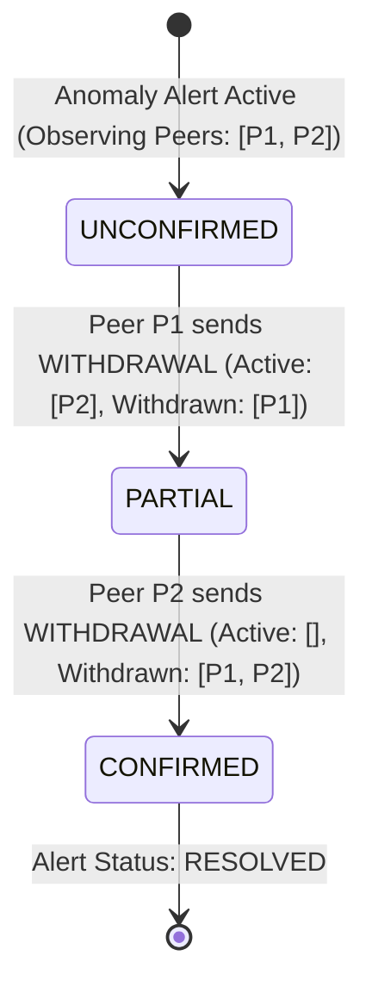
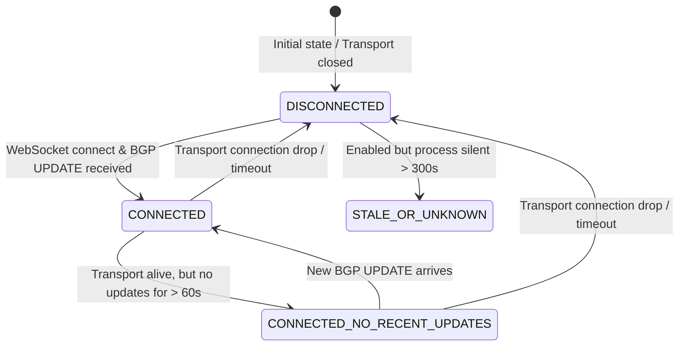
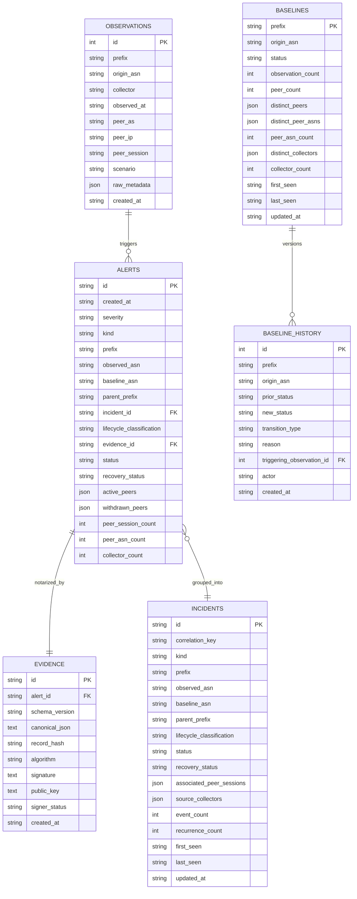

# HORA-Q — Architecture & System Design
### Complete Engineering Specifications, Component Boundaries, and State Machine Blueprints

**Author**: Google SOC Security Engineering Team / AIORI-3 PS-005  
**Project**: HORA-Q (Explainable BGP Origin and Subprefix Anomaly Monitor)  
**Target Standard**: Deterministic Zero-Trust BGP Anomaly Detection & Post-Quantum Cryptographic Attestation  

---

## 1. System Pipeline & Core Philosophy

HORA-Q operates as a continuous BGP route observation, anomaly detection, explainable root-cause classification, and cryptographic notarization pipeline. The architecture is structured around seven deterministic processing stages:


### Stage Breakdown:
1. **INGESTION**: Route updates arrive via REST API (`/api/v1/observations`), archival MRT BGP table dumps (`backend/horaq/replay.py`), or the opt-in live RIPE RIS WebSocket collector (`backend/horaq/collector.py`).
2. **NORMALIZATION**: IPv4/IPv6 CIDRs are stripped of non-zero host bits (`198.51.100.5/24` $\to$ `198.51.100.0/24`); ASNs are validated into canonical integer/string forms (`AS0`, negative numbers, and out-of-range 32-bit values are rejected); timestamps normalize to ISO 8601 UTC.
3. **BASELINE & QUARANTINE**: Unpromoted routes enter as `CANDIDATE`. A route is promoted to `PROMOTED` only when corroborated by multiple distinct observing peers (`peer_count >= 2` AND `observation_count >= 3`), or when explicitly initialized through the authenticated administrative endpoint (`/api/v1/baselines/seed`).
4. **ANOMALY ENGINE**: The engine evaluates incoming routes against established baselines for:
   * **Origin-AS Conflict**: An authorized prefix announced by a conflicting origin ASN.
   * **Subprefix Containment**: A more-specific subnet (e.g. `/25` inside `/24`, `/48` inside `/32`) announced by an unexpected origin, exploiting BGP Longest Prefix Match (LPM).
   * **Invariant**: Anomalous routes are quarantined and **never** poison reference baselines.
5. **INCIDENT CORRELATION**: Related conflict events within a configurable correlation window ($W = 3600\text{s}$) are linked to a logical incident without overwriting underlying evidence. Lifecycle classifications (`TRANSIENT`, `PERSISTENT`, `RECURRENT`) are assigned based on source duration.
6. **NOTARIZATION**: Incidents generate an immutable forensic record canonicalized according to **RFC 8785 JSON Canonicalization Scheme (JCS)**, hashed with **SHA-256**, and digitally signed using **NIST FIPS 204 ML-DSA-65** post-quantum lattice cryptography.
7. **VERIFICATION**: Standalone CLI (`verify_evidence.py`) and browser verification tools mathematically validate evidence integrity and signature authenticity outside the runtime environment.

---

## 2. Component Boundaries & Directory Layout

```
A3-PS005-TC416/
├── backend/                           # Python 3.10+ / FastAPI Backend Service
│   ├── horaq/                         # Core Python package
│   │   ├── config.py                  # Pydantic Settings & environment variables
│   │   ├── normalization.py           # IPv4/IPv6 prefix & ASN parsing rules
│   │   ├── database.py                # SQLite persistence, WAL transactions, migrations
│   │   ├── evidence.py                # RFC 8785 canonical JSON & SHA-256 hashing
│   │   ├── crypto.py                  # NIST FIPS 204 ML-DSA-65 provider & authority key
│   │   ├── rpki.py                    # RIPEstat REST client for ROA origin validation
│   │   ├── collector.py               # RIPE RIS Live WebSocket telemetry collector
│   │   ├── detection.py               # Detection engine, baseline quarantine & withdrawals
│   │   ├── api.py                     # FastAPI HTTP API router (/api/v1)
│   │   ├── benchmark.py               # 14-case head-to-head reference detector benchmark
│   │   ├── replay.py                  # Archival MRT historical incident replay engine
│   │   └── main.py                    # Application entrypoint, lifespan & CORS
│   ├── tests/                         # Pytest automated test suite (138 tests)
│   ├── scripts/                       # Replay and benchmark runner scripts
│   └── requirements.txt               # Pinned Python package dependencies
├── frontend/                          # React 18 + TypeScript + Vite Operations Console
│   ├── src/
│   │   ├── components/                # Modular UI components (EvidenceModal, RPKIModal, EvaluatorGuideCard)
│   │   ├── views/                     # Canvas views (Overview, Alerts, Routes, Scenarios, Evidence, RPKI)
│   │   ├── stores/                    # Zustand centralized reactive state
│   │   ├── types.ts                   # Domain schemas and API interfaces
│   │   └── api.ts                     # Type-safe HTTP client
│   └── package.json                   # Node.js dependencies & build scripts
├── docs/                              # Technical engineering documentation suite
├── audit/                             # Audit reports, evaluation JSON, and 16:9 UI screenshots
├── scripts/maintenance/               # Operational helper scripts (screenshot capture)
└── verify_evidence.py                 # Standalone independent evidence verification CLI
```

---

## 3. End-to-End System Sequence Diagram



---

## 4. State Machines & Architectural Invariants

### 4.1 Route Baseline State Machine



* **Anti-Poisoning Invariant**: An observation that triggers an `ORIGIN_CHANGE` or `SUBPREFIX_ANOMALY` alert **never transitions to `PROMOTED`**. The baseline retains its authorized origin.

---

### 4.2 Incident Correlation & Lifecycle State Machine

```mermaid
stateDiagram-v2
    [*] --> ACTIVE: Alert Generated (Key: Kind:Pfx:ObsASN:BaseASN:Rule)
    
    state ACTIVE {
        [*] --> TRANSIENT: First observation (Duration < 300s, Obs < 5)
        TRANSIENT --> PERSISTENT: Duration >= 300s OR Obs >= 5
    }
    
    ACTIVE --> RESOLVED: Route Withdrawn by ALL Active Announcing Peers
    
    state RESOLVED {
        [*] --> Remediated
        Remediated: Preserved in ledger; Evidence untouched
    }
    
    RESOLVED --> ACTIVE: Anomaly Reappears (Status: RECURRENT)
```



---

### 4.3 Per-Peer Anomaly Recovery State Machine



* **Premature Recovery Prevention**: A withdrawal from an unknown peer or a subset of announcing peers **never resolves the alert**. The anomaly remains `ACTIVE` with `recovery_status = 'PARTIAL'`.

---

### 4.4 Collector Transport Health State Machine



* **Disambiguation Invariant**: Collector disconnect or transport quietness **never calls `process_withdrawal()`** or alters baseline routing state.

---

## 5. Database Schema & Entity-Relationship Model

HORA-Q stores all operational data in **SQLite with Write-Ahead Logging (WAL)** mode enabled, using strict parameterized queries to guarantee transactional integrity and eliminate SQL injection:



---

## 6. Performance Profile & Computational Complexity

| Operation | Implementation | Time Complexity | Typical Latency |
| :--- | :--- | :---: | :---: |
| **Prefix & ASN Normalization** | `horaq.normalization` | $\mathcal{O}(1)$ | $< 0.05\text{ ms}$ |
| **Exact-Match Baseline Lookup** | SQLite Indexed B-Tree | $\mathcal{O}(\log N)$ | $< 0.15\text{ ms}$ |
| **Subprefix Containment Scan** | In-Memory LPM Range Match | $\mathcal{O}(B)$ | $< 0.40\text{ ms}$ |
| **Incident Correlation Grouping** | Indexed Key Search | $\mathcal{O}(\log I)$ | $< 0.20\text{ ms}$ |
| **RFC 8785 JSON Canonicalization** | Deterministic UTF-16 Sort | $\mathcal{O}(K \log K)$ | $< 0.12\text{ ms}$ |
| **SHA-256 Digest Computation** | OpenSSL C-Binding | $\mathcal{O}(M)$ | $< 0.02\text{ ms}$ |
| **ML-DSA-65 Digital Signing** | Dilithium-Py (NIST FIPS 204) | $\mathcal{O}(\text{ring operations})$ | $\sim 3.12\text{ ms}$ |
| **ML-DSA-65 Signature Verification** | Dilithium-Py (NIST FIPS 204) | $\mathcal{O}(\text{ring operations})$ | $\sim 0.85\text{ ms}$ |
