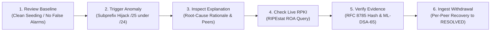

# HORA-Q — Evaluator Demonstration Guide

**Project**: HORA-Q (Explainable BGP Origin and Subprefix Anomaly Monitor)  
**Hackathon**: AIORI-3 | Track 2 Cyber Security (Problem PS-005, Team A3-PS005-TC416)  

---

## 1. Quickstart: Launching the System

### Step 1: Start Backend
```bash
cd backend
python -m uvicorn horaq.main:app --host 127.0.0.1 --port 8000 --reload
```
Interactive OpenAPI documentation will be accessible at: `http://127.0.0.1:8000/docs`

### Step 2: Start Frontend
```bash
cd frontend
npm run dev
```
Open your browser at: `http://localhost:5173/`

---

## 2. The 6-Stage Evaluator Guided Walkthrough

At the top of the **Overview** dashboard (`http://localhost:5173/`), evaluators are presented with the **AIORI-3 Level 2 Evaluator Guided Walkthrough** card. Evaluators can execute each stage sequentially with a single click:



### Stage 1: Establish Clean Baseline
- **What to click**: **`[Seed Reference Baseline]`** on the walkthrough card (or run Scenario 1 in Scenarios tab).
- **What is proven**: Establishes reference baseline `192.0.2.0/24` originating from authorized AS64496. Generates **0 alerts** (proving zero false alarms on clean seeding) and logs an `AUTHORIZED_SEED` entry in the immutable `baseline_history` table.

### Stage 2: Trigger Routing Anomaly (Subprefix Hijack)
- **What to click**: **`[Inject Subprefix Hijack]`** on the walkthrough card.
- **What is proven**: Rogue AS64500 announces `192.0.2.128/25` (a strict subnet of `192.0.2.0/24`). A high-severity `SUBPREFIX_ANOMALY` alert fires immediately. Crucially, the established `192.0.2.0/24` baseline route is **preserved against poisoning**.

### Stage 3: Inspect Root-Cause Explanation
- **What to click**: **`[Inspect Root-Cause Rationale]`** on the walkthrough card (or view the active alert in the Alerts tab).
- **What is proven**: Displays plain-English explanation of why the announcement was flagged (Longest Prefix Match exploitation), the parent prefix relationship, confidence score, and active observing peer tracking (`active_peers: ["AS64500"]`).

### Stage 4: Check Live RPKI Status
- **What to click**: **`[Query Live RPKI ROA]`** on the walkthrough card (or click **`[Check RPKI]`** on the alert card).
- **What is proven**: Pre-fills the prefix and origin into the RPKI Inspector tool, making a live query to RIPEstat's public REST API to evaluate cryptographic Route Origin Authorizations (ROAs).

### Stage 5: Verify Post-Quantum Cryptographic Evidence
- **What to click**: **`[Verify Cryptographic Evidence]`** on the walkthrough card (or click **`[Evidence]`** on the alert card).
- **What is proven**: Opens the Evidence Vault modal. Evaluators can:
  1. Inspect the RFC 8785 canonical JSON bytes (compact, sorted keys).
  2. Click **Verify Hash** to confirm SHA-256 integrity match.
  3. Click **Verify ML-DSA-65 Signature** to mathematically verify the NIST FIPS 204 post-quantum lattice signature.
  4. Use the **Tamper Sandbox** slider to mutate a field in memory (e.g. changing AS64505 to AS0) and watch SHA-256 verification instantly detect tamper and reject the forged record.

### Stage 6: Demonstrate Route Withdrawal Recovery
- **What to click**: **`[Ingest Route Withdrawal]`** on the walkthrough card (or click **`[Ingest Withdrawal]`** on the alert card in the Alerts view).
- **What is proven**: Ingests a BGP `WITHDRAWAL` message from observing peer AS64500. The active alert immediately transitions from `ACTIVE` to `RESOLVED` with `recovery_status="CONFIRMED"`, and the candidate subprefix route is marked `WITHDRAWN`.

---

## 3. Independent CLI Verification Demo

To demonstrate that verification does not depend on the browser or web server, open a terminal:

```bash
# Verify authentic ML-DSA-65 signed evidence record:
python verify_evidence.py audit/sample_evidence_signed.json
# Output: [PASS] SHA-256 digest match, [PASS] ML-DSA-65 signature authentic, Verdict: [AUTHENTIC] (Exit code 0)

# Demonstrate tamper detection:
python verify_evidence.py audit/sample_evidence_signed.json --tamper
# Output: [FAIL] TAMPER DETECTED, Verdict: [COMPROMISED] (Exit code 1)
```

---

## 4. Public Evaluation Demo Protections (`HORAQ_DEMO_MODE=true`)

When deployed publicly for evaluation, HORA-Q activates demo safeguards:
1. **Destructive Wipes Blocked**: Public users cannot wipe the database; reset operations perform a safe cleanup of test scenario alerts while preserving the reference baselines.
2. **Arbitrary Observation Injection Restricted**: Unauthenticated callers cannot spam raw route updates into the public database.
3. **Admin Token Bypass**: Evaluators with the administrative credential (`X-Admin-Token`) can perform administrative baseline seeding and full purges.
