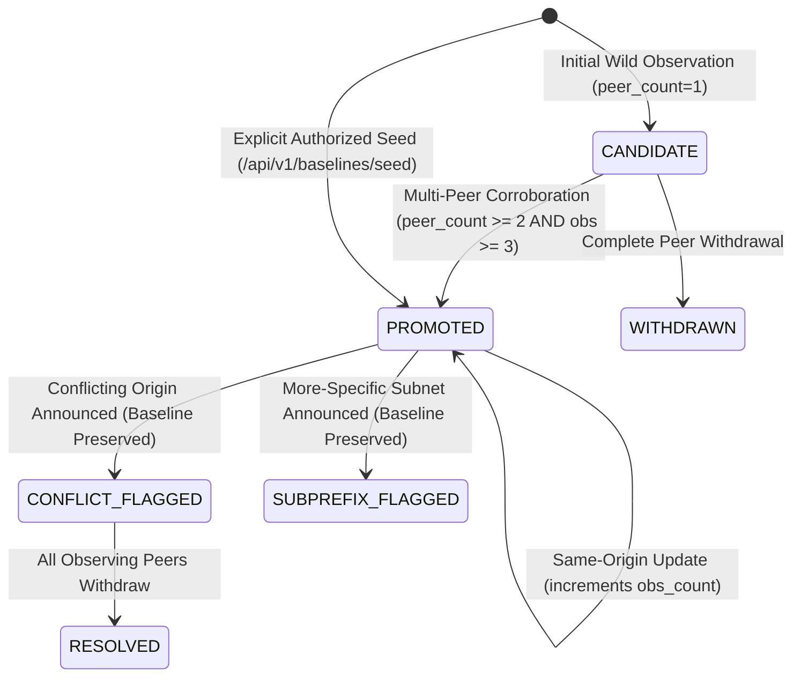

# HORA-Q — Detection Algorithms & Baseline Lifecycle

**Project**: HORA-Q (Explainable BGP Origin and Subprefix Anomaly Monitor)  
**Hackathon**: AIORI-3 | Track 2 Cyber Security (Problem PS-005, Team A3-PS005-TC416)  

---

## 1. Baseline Lifecycle & State Machine

In traditional BGP monitors, naive baseline learning immediately accepts incoming announcements, making the system vulnerable to **baseline poisoning** (where an attacker's initial malicious announcement permanently poisons routing memory). HORA-Q enforces a strict multi-stage lifecycle with multi-peer corroboration barriers and an immutable transition ledger.



### State Definitions
- **`CANDIDATE`**: Quarantined baseline state. The route is tracked in memory but not yet treated as authoritative for conflict evaluation. A single-peer flapping route cannot promote itself.
- **`PROMOTED`**: Authoritative reference baseline. Incoming announcements for this prefix or subnets under this prefix are evaluated against this baseline.
- **`WITHDRAWN`**: A candidate route whose observing peers have completely withdrawn announcements.
- **`REJECTED`**: Logged in immutable transition history when an anomalous announcement is actively blocked from poisoning the baseline store.

### Baseline Trust Barrier & Promotion Invariants
1. **No Caller Self-Promotion**: Wild route updates arriving via `POST /api/v1/observations` **cannot** elevate themselves to `PROMOTED` using caller-supplied metadata flags (such as `trusted_seed: true`) or scenario names. All uncorroborated observations enter as `CANDIDATE`.
2. **Peer Diversity Invariant**: A route can only transition from `CANDIDATE` to `PROMOTED` autonomously when observed across at least **two distinct peer ASNs or collectors** (`peer_count >= 2`) with at least **three total observations** (`observation_count >= 3`).
3. **Explicit Administrative Seeding**: An immediate `PROMOTED` baseline can only be created via the dedicated administrative endpoint:
   ```http
   POST /api/v1/baselines/seed
   Headers:
     X-Admin-Token: <secret-token>
   Body:
     {
       "prefix": "192.0.2.0/24",
       "origin_asn": "AS64496",
       "reason": "Authorized ISP upstream allocation"
     }
   ```
   In Demo Mode (`HORAQ_DEMO_MODE=true`), this endpoint strictly requires administrative credentials, preventing unauthenticated public tampering.

---

## 2. Immutable Baseline Version History

Every baseline lifecycle event is permanently recorded in the append-only `baseline_history` table in SQLite:

```sql
CREATE TABLE IF NOT EXISTS baseline_history (
    id INTEGER PRIMARY KEY AUTOINCREMENT,
    prefix TEXT NOT NULL,
    origin_asn TEXT NOT NULL,
    prior_status TEXT,
    new_status TEXT NOT NULL,
    transition_type TEXT NOT NULL,
    reason TEXT NOT NULL,
    peer_count INTEGER DEFAULT 1,
    observation_count INTEGER DEFAULT 1,
    actor TEXT DEFAULT 'SYSTEM_POLICY',
    created_at TEXT NOT NULL
);
```

### Supported Transition Types
- **`INITIAL_CANDIDATE`**: Initial unpromoted route observation quarantined under single-peer observation.
- **`AUTHORIZED_SEED`**: Explicit operator initialization via authenticated API.
- **`PROMOTED_CORROBORATED`**: Autonomous promotion achieved through multi-source peer corroboration (`peer_count >= 2`).
- **`WITHDRAWN`**: Route cleared by BGP withdrawal updates from all active peers.
- **`REJECTED_ATTEMPT`**: Forensic audit record created when an anomalous announcement (origin hijack or subprefix injection) conflicts with an existing baseline, documenting that the baseline remained unpoisoned.

The history is queryable at:
- `GET /api/v1/baselines/history?prefix=...&limit=50`
- `GET /api/v1/routes/{prefix:path}/history`

---

## 3. Detection Algorithms

### A. Origin-AS Conflict Detection
When a BGP update announces prefix $P$ originating from ASN $A_{\text{new}}$:
1. Lookup existing baseline for $P$ in `baselines`.
2. If baseline exists with status `PROMOTED` and origin $A_{\text{base}} \neq A_{\text{new}}$:
   - Generate `ORIGIN_CHANGE` alert with severity `HIGH`.
   - Record active observing peer ($A_{\text{peer}}$ or $A_{\text{new}}$).
   - Compute RFC 8785 canonical evidence payload and SHA-256 digest.
   - **Crucial Invariant**: The baseline table entry remains $A_{\text{base}}$. The rogue origin $A_{\text{new}}$ is never written into `baselines`.

### B. Subprefix Containment Anomaly Detection
BGP routers forward traffic according to the **Longest Prefix Match (LPM)** rule. An attacker who announces a more-specific subnet (e.g. `/25` inside `/24`) intercepts all traffic destined for that subnet globally, even if the parent prefix has valid RPKI coverage.

When a BGP update announces prefix $P_{\text{child}}$ (length $L_{\text{child}}$):
1. Query all established `PROMOTED` baselines $P_i$ (length $L_i$).
2. Evaluate subnet containment using IP network arithmetic:
   $$P_{\text{child}} \subsetneq P_i \iff (P_{\text{child}}.\text{network\_address} \in P_i) \land (L_{\text{child}} > L_i)$$
3. If one or more strict parent prefixes are found:
   - Select the closest parent (longest $L_i \le L_{\text{child}} - 1$).
   - If $A_{\text{child}} \neq A_{\text{parent}}$:
     - Flag `SUBPREFIX_ANOMALY` with severity `HIGH`.
     - Link `parent_prefix` in alert and evidence metadata.
     - Document LPM traffic redirection risk in explainable rationale.
     - Record `REJECTED_ATTEMPT` in `baseline_history`.
   - **Crucial Invariant**: $P_{\text{child}}$ is quarantined as an alert; it is strictly prohibited from entering `baselines`.

---

## 4. Per-Peer Route Withdrawal & Recovery Semantics

When BGP withdrawals occur (due to upstream filter application, DDoS mitigation, or origin de-announcement), incidents must resolve accurately without premature clearance or persistent false alerts.

### Processing Workflow (`process_withdrawal`)
1. **Audit Ingestion**: The withdrawal event is inserted into the `observations` audit log with `origin_asn = 'WITHDRAWAL'` and `raw_metadata.update_type = 'WITHDRAWAL'`.
2. **Active Alert Correlation**: Active alerts matching the withdrawn prefix are retrieved along with their JSON-encoded `active_peers` and `withdrawn_peers` lists.
3. **Per-Peer Resolution Rules**:
   - **Unidentified Peer (`peer_as = None`)**: Treated as unconfirmed telemetry. The alert remains `ACTIVE` with `recovery_status = 'UNCONFIRMED'`.
   - **Matching Active Peer**: If withdrawing peer $P_{\text{wdr}} \in \text{active\_peers}$:
     - Remove $P_{\text{wdr}}$ from `active_peers`; add to `withdrawn_peers`.
     - **Full Recovery**: If $\text{active\_peers} = \emptyset$, all observing peers have ceased propagation. Alert transitions to `status = 'RESOLVED'` with `recovery_status = 'CONFIRMED'`.
     - **Partial Recovery**: If $\text{active\_peers} \neq \emptyset$, anomalous propagation remains active from other peers. Alert remains `status = 'ACTIVE'` with `recovery_status = 'PARTIAL'`.
   - **Duplicate Withdrawal**: If $P_{\text{wdr}} \in \text{withdrawn\_peers}$, the request is idempotent; state is preserved without error.
4. **Candidate Route Transition**: If a candidate baseline exists for the withdrawn prefix, its status updates to `WITHDRAWN` and a transition is logged in `baseline_history`.
