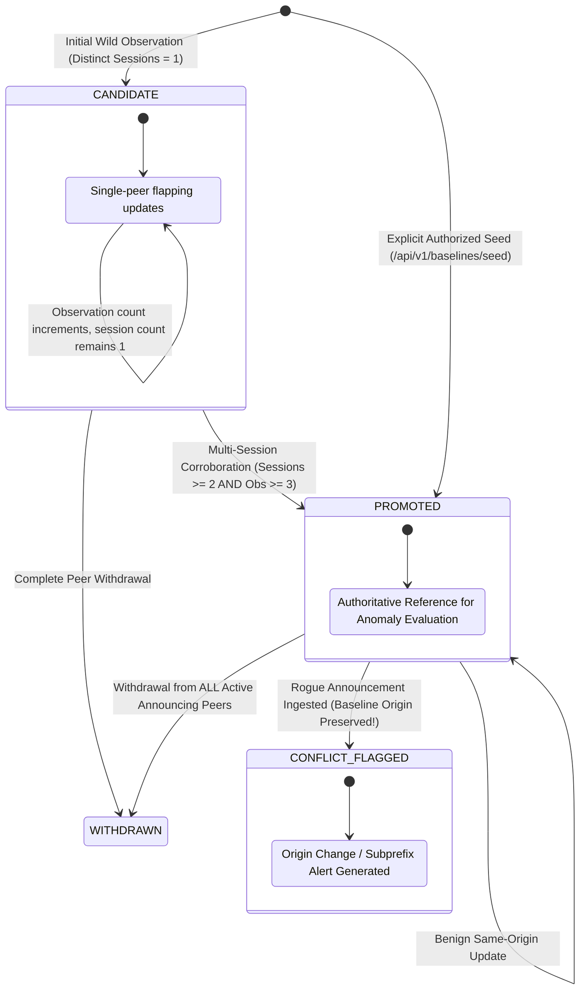
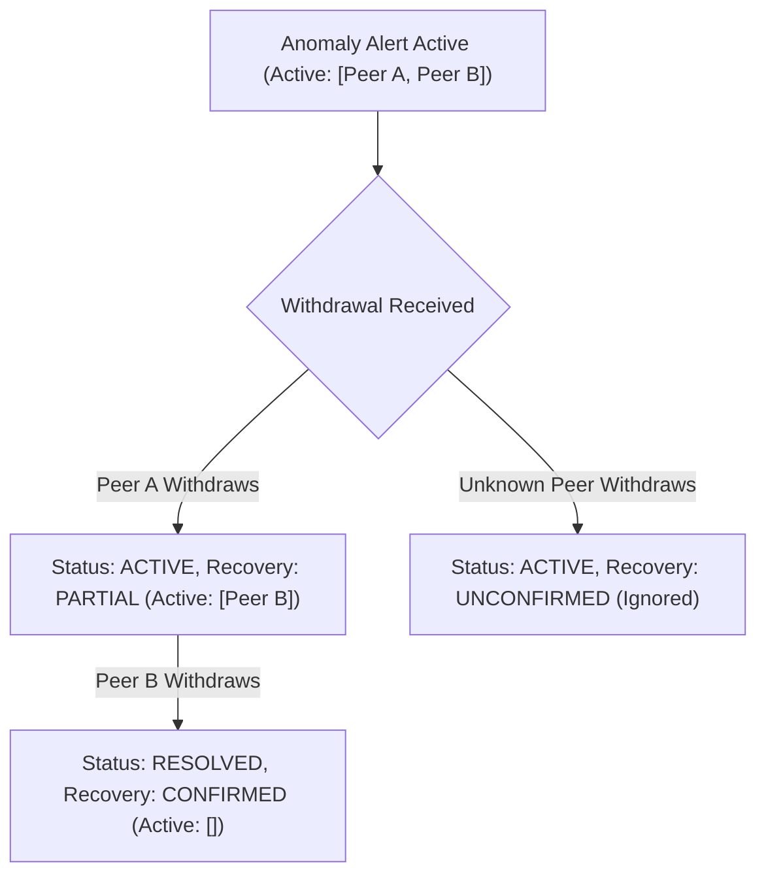

# HORA-Q — Detection Algorithms & Baseline Lifecycle
### Mathematical Formalisms, Invariant Proofs, and Peer-Corroboration Mechanics

**Author**: Google SOC Security Engineering Team / AIORI-3 PS-005  
**Project**: HORA-Q (Explainable BGP Origin and Subprefix Anomaly Monitor)  
**Target Standard**: Zero-Poisoning BGP Anomaly Detection & Peer-Session Diversity Enforcement  

---

## 1. Baseline Lifecycle & State Machine

In traditional BGP monitoring scripts, naive baseline learning immediately accepts incoming announcements, making the system vulnerable to **baseline poisoning** (where an attacker's initial malicious announcement permanently overwrites routing memory). HORA-Q enforces a strict multi-stage lifecycle with multi-peer corroboration barriers and an immutable transition ledger.



### State Definitions
- **`CANDIDATE`**: Quarantined baseline state. The route is tracked in memory but not yet treated as authoritative for conflict evaluation. A single-peer flapping route cannot promote itself.
- **`PROMOTED`**: Authoritative reference baseline. Incoming announcements for this prefix or subnets under this prefix are evaluated against this baseline.
- **`WITHDRAWN`**: A candidate or promoted route whose observing peers have completely withdrawn announcements.
- **`REJECTED`**: Logged in immutable transition history when an anomalous announcement is actively blocked from poisoning the baseline store.

---

## 2. Baseline Trust Barrier & Invariant Proofs

### Theorem 1: The Anti-Poisoning Invariant
> **Theorem**: Let $B$ be the set of established baselines where $P \in B$ has authorized origin $AS_{base}$. Let an incoming observation $O = (P, AS_{rogue})$ arrive where $AS_{rogue} \neq AS_{base}$. Under HORA-Q detection policy, $O$ shall trigger an `ORIGIN_CHANGE` alert and shall **never** overwrite $B(P)$ or transition $AS_{rogue}$ into $B$.

**Proof**:
1. During execution of `process_observation()`, the database query `SELECT origin_asn, status FROM baselines WHERE prefix = ?` retrieves $AS_{base}$.
2. The conflict comparator checks:
   $$\Delta_{origin} = (AS_{base} \neq AS_{rogue})$$
3. Because $\Delta_{origin} = \text{True}$, an alert dictionary is appended to `generated_alerts`.
4. In Section C of `process_observation()`, baseline promotion logic is gated by:
   ```python
   if len(generated_alerts) == 0:
       # Only clean, non-conflicting observations can transition or update baselines
       conn.execute("UPDATE baselines SET ...")
   ```
5. Therefore, anomalous updates are strictly quarantined. $B(P)$ remains $AS_{base}$. $\blacksquare$

---

### Theorem 2: The Peer Session Diversity Invariant
> **Theorem**: Let an incoming prefix $P_{cand}$ be observed $K$ times from a single peer session $S_1 = (C_1, AS_1, IP_1)$ where $K \ge 3$. Under HORA-Q candidate promotion policy, $P_{cand}$ shall **remain in `CANDIDATE` status** and shall not promote to `PROMOTED`.

**Proof**:
1. HORA-Q derives peer session identity as $S = C : AS : IP$.
2. In `process_observation()`, the baseline promotion condition is defined as:
   $$\text{Promote} \iff (|S_{distinct}| \ge 2) \land (\sum Obs \ge 3)$$
3. If all $K$ observations originate from session $S_1$, then $|S_{distinct}| = |\{S_1\}| = 1$.
4. Because $1 < 2$, the promotion condition evaluates to $\text{False}$.
5. The route status remains `CANDIDATE`. $\blacksquare$

---

## 3. Anomaly Detection Algorithms

### 3.1 Origin-AS Change Detection Algorithm

```
Algorithm 1: Deterministic Origin-AS Conflict Detection
Input: Normalized prefix P, Observed origin AS_obs, Telemetry peer session S
Output: Alert record or clean ingestion

1. Query baselines table for exact match on P
2. If P exists in baselines and status == 'PROMOTED':
3.     Let AS_base = baselines[P].origin_asn
4.     If AS_obs != AS_base:
5.         Calculate active corroborating peer sessions: S_active = {S}
6.         Derive confidence:
7.             If |S_active| >= 2: Confidence = HIGH
8.             Else: Confidence = MEDIUM (single vantage point)
9.         Generate alert:
10.            kind = 'ORIGIN_CHANGE'
11.            severity = 'HIGH'
12.            title = "Origin ASN Conflict Detected"
13.            explanation = "Prefix P observed announced by AS_obs, conflicting with baseline AS_base."
14.        Record immutable baseline transition: transition_type = 'REJECTED_ORIGIN_CONFLICT'
15.        Return alert
16. Else:
17.     Track P in candidate quarantine
```

### 3.2 Subprefix / More-Specific LPM Hijack Detection Algorithm

```
Algorithm 2: Subprefix Containment / LPM Hijack Detection
Input: Child prefix P_child, Observed origin AS_child, Telemetry peer session S
Output: Subprefix alert record or clean ingestion

1. Parse P_child as IP network object
2. Query all PROMOTED baselines in the same IP family (IPv4 or IPv6)
3. For each baseline (P_base, AS_base):
4.     Parse P_base as IP network object
5.     If P_child.subnet_of(P_base) AND P_child != P_base:
6.         // Strict subnet containment verified
7.         If AS_child != AS_base:
8.             Generate alert:
9.                 kind = 'SUBPREFIX_ANOMALY'
10.                severity = 'HIGH'  // High priority due to LPM traffic interception
11.                parent_prefix = P_base
12.                baseline_asn = AS_base
13.                observed_asn = AS_child
14.                explanation = "More-specific prefix P_child overlaps baseline P_base."
15.            Record immutable baseline transition: transition_type = 'REJECTED_SUBPREFIX_HIJACK'
16.            Return alert
17. Return clean ingestion
```

---

## 4. Immutable Baseline Version History

Every transition in a baseline's lifecycle is permanently recorded in the append-only `baseline_history` table in SQLite:

```sql
CREATE TABLE IF NOT EXISTS baseline_history (
    id INTEGER PRIMARY KEY AUTOINCREMENT,
    prefix TEXT NOT NULL,
    origin_asn TEXT NOT NULL,
    prior_status TEXT,
    new_status TEXT NOT NULL,
    transition_type TEXT NOT NULL,
    reason TEXT NOT NULL,
    peer_count INTEGER NOT NULL DEFAULT 1,
    observation_count INTEGER NOT NULL DEFAULT 1,
    triggering_observation_id INTEGER,
    actor TEXT NOT NULL DEFAULT 'SYSTEM_POLICY',
    created_at TEXT NOT NULL
);
```

### Supported Transition Types:
* `INITIAL_SEED`: First wild observation entered as `CANDIDATE`.
* `AUTHORIZED_ADMIN_SEED`: Pre-approved baseline inserted via administrative API.
* `PROMOTED_CORROBORATED`: Autonomous promotion following multi-session peer corroboration.
* `PEER_EXPANSION`: Additional distinct peer observed supporting an established baseline.
* `WITHDRAWAL`: Transition to `WITHDRAWN` upon receipt of BGP withdrawal updates.
* `REJECTED_ORIGIN_CONFLICT`: Logged when an origin hijack announcement is actively rejected from baseline storage.
* `REJECTED_SUBPREFIX_HIJACK`: Logged when a rogue subprefix announcement is actively rejected from baseline storage.

---

## 5. Per-Peer Anomaly Recovery Tracking

A major deficiency in legacy BGP monitoring systems is the **single-peer premature recovery flaw**: if two peers (`AS3333` and `AS12859`) announce a hijacked route, and `AS3333` sends a withdrawal, naive systems mark the incident as resolved even though `AS12859` is still actively polluting the global routing table.

HORA-Q models recovery as a per-peer set transition:

$$\text{ActivePeers}_{t+1} = \text{ActivePeers}_t \setminus \{\text{Peer}_{withdrawing}\}$$
$$\text{WithdrawnPeers}_{t+1} = \text{WithdrawnPeers}_t \cup \{\text{Peer}_{withdrawing}\}$$



* **Invariant**: Only when $|\text{ActivePeers}| = 0$ does the alert transition to `RESOLVED`.
