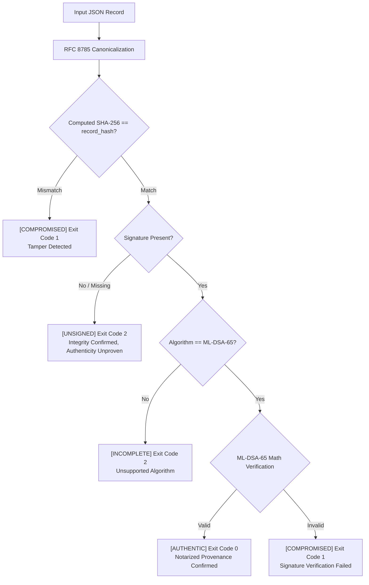

# HORA-Q — Evidence Integrity & Post-Quantum Cryptography

**Project**: HORA-Q (Explainable BGP Origin and Subprefix Anomaly Monitor)  
**Hackathon**: AIORI-3 | Track 2 Cyber Security (Problem PS-005, Team A3-PS005-TC416)  

---

## 1. Cryptographic Evidence Architecture

Every BGP anomaly detected by HORA-Q produces an immutable, tamper-evident forensic evidence entry. The notarization pipeline enforces three independent mathematical layers:

```
┌─────────────────────────┐
│   Raw Incident Record   │  (Alert context, prefix, origins, peers, timestamp)
└────────────┬────────────┘
             │
             ▼
┌─────────────────────────┐
│  1. RFC 8785 JCS Bytes  │  (Strict UTF-16 code unit key sorting, compact delimiters)
└────────────┬────────────┘
             │
             ▼
┌─────────────────────────┐
│   2. SHA-256 Digest     │  (Cryptographic payload integrity binding)
└────────────┬────────────┘
             │
             ▼
┌─────────────────────────┐
│  3. NIST FIPS 204 ML-DSA│  (Lattice-based post-quantum signature for non-repudiation)
└─────────────────────────┘
```

---

## 2. RFC 8785 JSON Canonicalization Scheme (JCS)

Standard JSON serializers (like Python's default `json.dumps` or JavaScript's `JSON.stringify`) exhibit non-deterministic key ordering, floating point differences, and whitespace variance across operating systems. This causes identical logical data to produce different SHA-256 digests.

HORA-Q strictly implements **RFC 8785 (JCS)** via the standard `rfc8785` package and deterministic fallback:

1. **UTF-16 Code Unit Key Sorting**: Dictionary keys are sorted lexicographically by UTF-16 code unit values rather than Unicode codepoints.
2. **Compact Formatting**: Delimiters use strictly `','` and `':'` with zero surrounding whitespace.
3. **Number Serialization**: Numbers follow ECMAScript 6 specifications (integers are exact; exponential notation is standardized; `NaN` and `Infinity` are rejected).
4. **UTF-8 Encoding**: The canonical string is encoded to binary bytes using UTF-8.

---

## 3. NIST FIPS 204 ML-DSA-65 (Module-Lattice Digital Signatures)

To protect forensic evidence against future quantum adversaries capable of breaking RSA and ECDSA via Shor's algorithm, HORA-Q standardizes on **ML-DSA-65** (formerly Dilithium3), standardized by NIST in **FIPS 204** (August 2024).

### Cryptographic Parameters
- **Security Level**: NIST Security Category 3 (equivalent to AES-192 / SHA-384 security against classical and quantum attacks).
- **Matrix Dimensions**: Module dimensions $k=6, l=5$ over polynomial ring $\mathbb{Z}_q[X]/(X^{256} + 1)$ with modulus $q = 8380417$.
- **Public Key Size**: 1,952 bytes (Base64-encoded: 2,604 characters).
- **Signature Size**: 3,309 bytes (Base64-encoded: 4,412 characters).

### Strict No-Substitution Invariant
In accordance with AIORI-3 evaluation criteria:
- The system **strictly refuses** to silently substitute classical keys (RSA/ECDSA) or fabricate dummy signature strings.
- If the post-quantum provider (`liboqs` or `dilithium-py`) is not present in the runtime environment, the service transparently reports `status: "PROVIDER_UNAVAILABLE"` and leaves records as `signer_status: "UNSIGNED"`.
- This behavior is verified by automated test [`test_crypto_status_reporting`](../backend/tests/test_crypto.py).

### Persistent Authority Key Lifecycle
Authority signing keys are managed deterministically:
- Stored exclusively at the configured path (`HORAQ_SIGNING_KEY`, defaulting to `horaq_authority_key.json`).
- If an authority keypair exists, it is loaded and re-used; it is **never** silently regenerated upon service restart.
- The path is strictly absolute, ensuring persistence regardless of process working directory.
- Private key bytes are NEVER exposed through public APIs or client-side bundles.

---

## 4. Independent Command-Line Verifier (`verify_evidence.py`)

A critical scientific differentiator of HORA-Q is the standalone verification CLI. Evaluators and auditors can cryptographically inspect and verify evidence records **completely outside the browser, web server, and database**:

```bash
# 1. Verify authentic ML-DSA-65 signed evidence record (Exit code 0):
python verify_evidence.py audit/sample_evidence_signed.json

# 2. Demonstrate tamper detection on signed record (Exit code 1):
python verify_evidence.py audit/sample_evidence_signed.json --tamper

# 3. Verify that an unsigned record cannot receive an authentic verdict (Exit code 2):
python verify_evidence.py audit/sample_evidence_unsigned.json

# 4. Demonstrate tamper detection on unsigned record (Exit code 1):
python verify_evidence.py audit/sample_evidence_unsigned.json --tamper
```

### Verification State Machine & Exit Codes



### Verification Guarantees
1. **Authenticity Separation**: An SHA-256 digest alone proves content integrity (the record has not changed since hash generation), but **cannot** establish authenticity or provenance without an authority signature. An unsigned record exits with code `2`.
2. **Byte-Level Parity**: The independent verifier implements the identical RFC 8785 canonicalization routine as the backend, verified to byte-level parity by automated test [`test_backend_and_independent_verifier_byte_parity`](../backend/tests/test_evidence.py).
3. **Tamper Rejection**: Any modification to prefix, origin ASN, timestamp, or context flips the SHA-256 digest and causes immediate rejection with exit code `1`.
