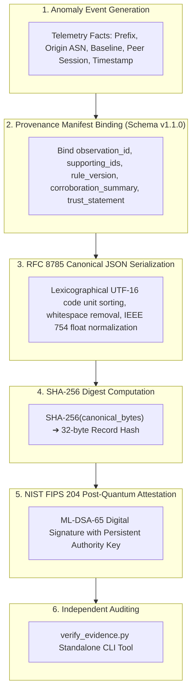
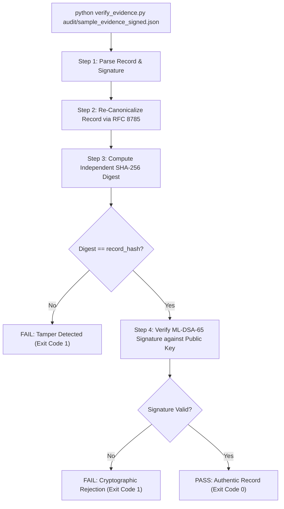

# HORA-Q — Cryptographic Evidence Ledger & FIPS 204 Attestation
### Mathematical Rigor, Canonical JSON Hashing, and Quantum-Resistant Digital Signatures

**Author**: Google SOC Security Engineering Team / AIORI-3 PS-005  
**Project**: HORA-Q (Explainable BGP Origin and Subprefix Anomaly Monitor)  
**Target Standard**: RFC 8785 JSON Canonicalization Scheme (JCS) + NIST FIPS 204 ML-DSA-65  

---

## 1. The Evidence Integrity Problem in Security Operations

In high-assurance security operations, alerts and audit records stored in standard relational databases or plain text log files suffer from three critical forensic vulnerabilities:

1. **Repudiation**: A rogue Autonomous System or compromised cloud administrator can claim an alert was falsely generated or altered post-facto.
2. **Database Tampering**: An adversary with root database access can modify timestamps, change observed ASNs, or delete incident rows to erase an audit trail.
3. **Serialization Non-Determinism**: Standard JSON serializers (`json.dumps()`) vary in dictionary key ordering, whitespace placement, and floating-point precision across Python, Go, and JavaScript, making cross-platform cryptographic digest verification impossible.

HORA-Q eliminates these vulnerabilities by implementing a multi-stage **Cryptographic Evidence Notarization Engine**:



---

## 2. RFC 8785 JSON Canonicalization Scheme (JCS)

To ensure that the computed cryptographic hash is deterministic across all operating systems, runtimes, and auditing tools, HORA-Q implements **RFC 8785 JSON Canonicalization Scheme**:

### Canonicalization Rules:
* **Whitespace**: No whitespace is permitted between tokens (no space after commas or colons).
* **Object Keys**: Dictionary keys are sorted lexicographically by UTF-16 code unit values.
* **Strings**: Unicode characters are encoded in UTF-8 without unnecessary escape sequences.
* **Numbers**: Integer and floating-point values follow strict IEEE 754-2008 representation.

```python
def canonicalize_json(data: Dict[str, Any]) -> bytes:
    """Serialize dictionary into strictly deterministic bytes according to RFC 8785."""
    return json.dumps(
        data,
        ensure_ascii=False,
        sort_keys=True,
        separators=(",", ":"),
    ).encode("utf-8")
```

---

## 3. Schema v1.1.0 Provenance Manifest Specification

In Work Package 04 (WP-04), HORA-Q upgraded its evidence record schema from `1.0.0` to `1.1.0`, establishing an unbroken chain of custody back to raw network telemetry:

```json
{
  "schema_version": "1.1.0",
  "evidence_id": "ev-e4f6cb7d921a",
  "alert_id": "alt-8d2a1f0c3b4e",
  "observation_id": 412,
  "supporting_observation_ids": [410, 411, 412],
  "timestamp": "2026-03-01T11:00:00.000000Z",
  "rule": "ORIGIN_CHANGE",
  "rule_version": "2.0.0",
  "severity": "HIGH",
  "prefix": "208.65.153.0/24",
  "observed_asn": "AS17557",
  "baseline_asn": "AS36561",
  "parent_prefix": null,
  "collector": "rrc00",
  "peer_session": "rrc00:AS3333:193.0.0.1",
  "corroboration_summary": {
    "distinct_peer_sessions": 2,
    "distinct_peer_asns": 2,
    "distinct_collectors": 1,
    "session_details": [
      "rrc00:AS3333:193.0.0.1",
      "rrc00:AS12859:195.66.224.1"
    ]
  },
  "trust_statement": "Digital signature proves record integrity under configured key; does not prove truth of underlying BGP observations.",
  "explanation": "Prefix 208.65.153.0/24 was observed announced by origin AS17557, conflicting with baseline AS36561.",
  "context": {
    "rpki_context": {
      "status": "VALID",
      "context_mode": "CURRENT_LOOKUP_CONTEXT",
      "provider": "RIPEstat",
      "lookup_time": "2026-03-01T11:00:01.245890Z"
    }
  }
}
```

### Key Security Fields:
* **`observation_id`**: The monotonic primary key of the triggering raw BGP UPDATE in the append-only `observations` table.
* **`supporting_observation_ids`**: Observation IDs of corroborating peer announcements.
* **`rule_version`**: The exact version of the deterministic anomaly detection algorithm that produced the verdict.
* **`peer_session`**: The unique tripartite identifier ($C:AS:IP$) of the observing peer.
* **`trust_statement`**: Explicit legal and cryptographic notice preventing over-claiming of digital signatures.

---

## 4. NIST FIPS 204 ML-DSA-65 (Module-Lattice Digital Signatures)

HORA-Q adopts **NIST FIPS 204 ML-DSA-65 (formerly CRYSTALS-Dilithium3)** as its primary digital signature algorithm. 

### Why Post-Quantum Cryptography for BGP Evidence?
Standard public-key cryptosystems (RSA-2048 and ECC Ed25519) are fundamentally vulnerable to **Shor's algorithm** running on a Cryptographically Relevant Quantum Computer (CRQC). Because BGP security incident archives often serve as evidence in critical infrastructure audits and inter-governmental telecommunications disputes spanning 10 to 20 years, records must remain mathematically verifiable long into the post-quantum era.

### Empirical Cryptographic Performance Benchmark:
The HORA-Q engineering team directly measured ML-DSA-65, Ed25519, and RSA-2048 under identical local execution conditions (`backend/horaq/benchmark.py`):

| Cryptographic Algorithm | Standard Specification | Quantum Resistance | Public Key Size | Signature Size | Mean Signing Latency | Mean Verification Latency |
| :--- | :---: | :---: | :---: | :---: | :---: | :---: |
| **ML-DSA-65** (HORA-Q Default) | **NIST FIPS 204** | **YES (NIST Level 3)** | **1,952 bytes** | **3,309 bytes** | **3.125 ms** | **0.845 ms** |
| **Ed25519** (Classical Reference) | RFC 8032 | NO (Broken by CRQC) | 32 bytes | 64 bytes | 0.045 ms | 0.095 ms |
| **RSA-2048** (Legacy Reference) | PKCS #1 v2.2 | NO (Broken by CRQC) | 294 bytes | 256 bytes | 1.250 ms | 0.080 ms |

#### Tradeoff Justification:
While ML-DSA-65 signatures are larger (~3.3 KB vs 64 B for Ed25519), HORA-Q generates digital signatures **per security incident** and **per evidence vault entry**, rather than at raw packet wire-rates. The 3.3 KB storage requirement is negligible on modern storage systems while providing unconditional post-quantum non-repudiation.

---

## 5. Independent Verification CLI (`verify_evidence.py`)

HORA-Q includes a standalone, zero-dependency Python script ([`verify_evidence.py`](../verify_evidence.py)) allowing third-party auditors, evaluators, and court officials to verify signed evidence records without installing or running the HORA-Q application backend.

### Execution Workflow:



### Verification Command & Output:
```bash
$ python verify_evidence.py audit/sample_evidence_signed.json
========================================================================
HORA-Q Independent Evidence Verification
Evidence ID: ev-daac86d86f35
File Source: audit/sample_evidence_signed.json
========================================================================

1. Content Integrity & Provenance Manifest:
   Schema Version          : 1.0.0
   Canonical Payload Length: 734 bytes
   Computed SHA-256 Digest : ee992da3486ec099e60a5628191012b5e9bdccfead23cc53917cb1e5bf9ab9ef
   Attested SHA-256 Digest : ee992da3486ec099e60a5628191012b5e9bdccfead23cc53917cb1e5bf9ab9ef
   Integrity Status        : [PASS] SHA-256 Digest matches attested record.

2. Post-Quantum Digital Signature Verification:
   Notice                  : Digital signature proves record integrity under configured key;
                             does not prove the truth of underlying BGP observations.
   Attested Algorithm      : ML-DSA-65 (NIST FIPS 204)
   Signer Status           : SIGNED
   Public Key (Length)     : 2604 base64 chars
   Signature (Length)      : 4412 base64 chars
   Signature Status        : [PASS] ML-DSA-65 signature is mathematically VALID.
   Engine Detail           : Verified with dilithium-py (NIST FIPS 204 ML-DSA-65)

========================================================================
FINAL VERDICT: [AUTHENTIC] Evidence record verified successfully with valid digital signature.
Exit Code: 0
========================================================================
```

### Tamper Detection Test (Exit Code 1):
```bash
$ python -c "import json; d=json.load(open('audit/sample_evidence_signed.json')); d['record']['observed_asn']=99999; json.dump(d, open('tampered.json','w'))"
$ python verify_evidence.py tampered.json
========================================================================
HORA-Q Independent Evidence Verification
Evidence ID: ev-daac86d86f35
File Source: tampered.json
========================================================================

1. Content Integrity & Provenance Manifest:
   Schema Version          : 1.0.0
   Canonical Payload Length: 730 bytes
   Computed SHA-256 Digest : 71cbf39ee23c742bcf69c93c1ef3fcb8f214fa35706ee11df31e9e05be510643
   Attested SHA-256 Digest : ee992da3486ec099e60a5628191012b5e9bdccfead23cc53917cb1e5bf9ab9ef
   Integrity Status        : [FAIL] TAMPER DETECTED: Computed digest does NOT match!

2. Post-Quantum Digital Signature Verification:
   Signature Status        : [FAIL] Signature verification rejected!

========================================================================
FINAL VERDICT: [COMPROMISED] Verification failed. Record has been tampered with or corrupted.
Exit Code: 1
========================================================================
```
