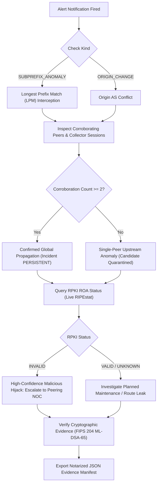

# HORA-Q — Operations, Deployment & Runbook

**Project**: HORA-Q (Explainable BGP Origin and Subprefix Anomaly Monitor)  
**Hackathon**: AIORI-3 | Track 2 Cyber Security (Problem PS-005, Team A3-PS005-TC416)  
**Standard**: Google SOC Enterprise Production Operational Runbook  

---

## 1. Operational Architecture & Deployment Topology

HORA-Q operates as a decoupled, cloud-native telemetry pipeline consisting of an asynchronous FastAPI backend service, an SQLite WAL operational datastore, and a client-side React 19 / TypeScript Single Page Application (SPA).

```
  +---------------------------------------------------------------------------------+
  |                                 Public Internet                                 |
  +---------------------------------------------------------------------------------+
            |                                                      |
            | HTTPS / WSS                                          | HTTPS / Assets
            v                                                      v
  +-------------------------------------+                +--------------------------+
  |        Render Web Service           |                |     Cloudflare Pages     |
  |  https://a3-ps005-tc416.onrender.com|                | https://horaq-frontends. |
  |                                     |                | pages.dev                |
  |  +-------------------------------+  |   JSON / CORS  |                          |
  |  |  FastAPI (Uvicorn / Py 3.13)  |<-+----------------| React 19 + Vite Frontend |
  |  +-------------------------------+  |                | In-Browser FIPS 204      |
  |  |  Post-Quantum ML-DSA-65 Signer|  |                | Evidence Verification    |
  |  +-------------------------------+  |                +--------------------------+
  |  |  SQLite 3 (WAL Mode + Pragma) |  |                             ^
  |  +-------------------------------+  |                             |
  |                 ^                   |                             |
  +-----------------|-------------------+                             |
                    |                                                 |
         WebSocket  |                                                 |
                    v                                                 |
  +-------------------------------------+                             |
  |      RIPE RIS Live Telemetry        |                             |
  |  wss://ris-live.ripe.net/v1/stream  |-----------------------------+
  |      (rrc00, rrc01, rrc03)          |
  +-------------------------------------+
```

---

## 2. Environment Variables & Runtime Configuration

The backend configuration is managed strictly through Pydantic Settings (`backend/horaq/config.py`). All configuration parameters can be passed via environment variables, container environment injection, or a local `.env` file:

| Environment Variable | Default Value | Production Recommended | Description |
| :--- | :--- | :--- | :--- |
| `PORT` | `8000` | `10000` (Render) / `8000` | HTTP port for FastAPI Uvicorn listener. |
| `HORAQ_DATABASE` | `horaq.db` | `/data/horaq.db` | Path to persistent SQLite database file. Mount on a persistent volume in containerized environments. |
| `HORAQ_SIGNING_KEY` | `horaq_authority_key.json` | `/data/horaq_authority_key.json` | Path to persistent NIST FIPS 204 ML-DSA-65 authority key. Must be preserved across container restarts to prevent key invalidation. |
| `HORAQ_DEMO_MODE` | `false` | `true` | Enables public evaluation demo protections (blocks unauthenticated database wipes and administrative route seeding). |
| `HORAQ_ADMIN_TOKEN` | `""` | Strong entropy secret | Secret bearer token required for administrative baseline seeding (`POST /api/v1/baselines/seed`) and database resets when Demo Mode is active. |
| `HORAQ_LIVE_COLLECTOR` | `false` | `false` (Eval) / `true` (Live) | Controls the background RIPE RIS WebSocket collector task. Default `false` guarantees deterministic evaluation. |
| `HORAQ_RIS_URL` | `wss://ris-live.ripe.net/v1/stream/` | `wss://ris-live.ripe.net/v1/stream/` | Upstream WebSocket stream endpoint for live BGP UPDATE telemetry. |
| `HORAQ_CORS_ORIGINS` | `*` | `https://horaq-frontends.pages.dev,http://localhost:5173` | Comma-separated list of allowed frontend origins. Supports wildcard patterns like `https://*.pages.dev`. |
| `PYTHON_VERSION` | `3.13.0` | `3.13.0` | Python runtime version for container builders (Render / Railway / Docker). |

---

## 3. Production Deployment Guide

### 3.1 Backend Deployment on Render.com

Render provides managed containerized hosting with continuous Git deployment from GitHub.

1. **Create Web Service**:
   - In the Render Dashboard, select **New +** $\to$ **Web Service**.
   - Connect the repository: `https://github.com/aiori-hackathon/A3-PS005-TC416`.
   - Branch: `main` (or active release branch).
2. **Build & Runtime Configuration**:
   - **Environment**: `Python 3`
   - **Build Command**: `pip install -r backend/requirements.txt`
   - **Start Command**: `uvicorn backend.horaq.main:app --host 0.0.0.0 --port $PORT`
3. **Environment Variables**:
   ```ini
   PYTHON_VERSION = 3.13.0
   HORAQ_DEMO_MODE = true
   HORAQ_ADMIN_TOKEN = <generate-secure-random-token>
   HORAQ_CORS_ORIGINS = https://horaq-frontends.pages.dev,https://*.pages.dev,http://localhost:5173
   HORAQ_LIVE_COLLECTOR = false
   ```
4. **Health Check Path**:
   - Set Health Check Path to `/health`.
5. **Handling Free-Tier Spin Down**:
   - Render free instances spin down after 15 minutes of inactivity. The initial HTTP request may experience a 30–50 second cold-start delay. The frontend includes automatic retry and timeout handling for cold starts.

---

### 3.2 Frontend Deployment on Cloudflare Pages

Cloudflare Pages provides global edge CDN distribution with zero cold-start latency.

1. **Connect Repository**:
   - In Cloudflare Dashboard, navigate to **Workers & Pages** $\to$ **Create an application** $\to$ **Pages** $\to$ **Connect to Git**.
   - Select `vssankardev-lang/horaq-frontend` (or repository containing `frontend/`).
2. **Build Settings**:
   - **Framework Preset**: `Vite`
   - **Build Command**: `npm run build`
   - **Build Output Directory**: `dist`
   - **Root Directory**: `frontend` (or `/` if deploying dedicated frontend repo).
3. **Environment Variables**:
   ```ini
   VITE_API_URL = https://a3-ps005-tc416.onrender.com
   NODE_VERSION = 20
   ```
4. **Edge Header Configuration (`_headers`)**:
   Ensure `frontend/public/_headers` includes security headers:
   ```http
   /*
     X-Content-Type-Options: nosniff
     X-Frame-Options: DENY
     Referrer-Policy: strict-origin-when-cross-origin
     Access-Control-Allow-Origin: *
   ```

---

### 3.3 CORS Resolution & Troubleshooting

If the frontend displays:
`Access to fetch at 'https://...onrender.com/api/v1/overview' from origin 'https://...pages.dev' has been blocked by CORS policy`

1. **Root Cause**: The backend's `HORAQ_CORS_ORIGINS` setting did not match the requesting Cloudflare Pages URL or preview domain.
2. **Resolution**:
   - In Render Dashboard $\to$ Environment, update `HORAQ_CORS_ORIGINS`:
     ```ini
     HORAQ_CORS_ORIGINS = https://horaq-frontends.pages.dev,https://*.pages.dev,http://localhost:5173
     ```
   - Trigger a manual deploy or restart the service to apply changes.
   - Alternatively, setting `HORAQ_CORS_ORIGINS = *` permits all origins during hackathon evaluation.

---

## 4. Operational Runbook for SOC Operators

### 4.1 Triaging an Anomaly Alert

When a `CRITICAL` or `HIGH` severity alert fires on the Operator Console:



1. **Locate the Alert**: Open the **Alerts & Incidents** tab in the console.
2. **Review Prefix & Origins**:
   - Compare `affected_prefix` against `parent_prefix`.
   - Identify `observed_asn` vs `baseline_asn`.
3. **Verify Corroboration**:
   - Check the **Corroborating Peer Sessions** count.
   - If count is `1`, the event is an isolated peer anomaly or flap; candidate baseline quarantine prevents network contamination.
   - If count is $\ge 2$ across distinct collectors, global propagation has begun.
4. **Inspect RPKI Validation**:
   - Check RPKI badge: `VALID`, `INVALID`, `UNKNOWN`, or `HISTORICAL_RPKI_UNAVAILABLE`.
   - An `INVALID` status alongside multi-peer corroboration confirms a high-confidence hijack.
5. **Download Signed Evidence**:
   - Click **Verify Cryptography**.
   - Download the canonical `.json` evidence record for upstream ISP dispute resolution or regulatory filing.

---

### 4.2 Handling Route Withdrawals & Mitigation Verification

When the rogue autonomous system withdraws the hijacked route:

1. **Ingest Withdrawal**: The RIPE RIS collector receives the BGP `WITHDRAW` message.
2. **Automated Recovery State Machine**:
   - If the withdrawal covers a subset of announcing peers, the alert shifts to `recovery_status: PARTIAL`.
   - When all announcing peer sessions withdraw the route, the alert transitions to `status: RESOLVED` and `recovery_status: CONFIRMED`.
3. **Candidate De-escalation**: Quarantined candidate routes associated exclusively with the rogue origin are safely purged without affecting the legitimate baseline.

---

### 4.3 Database Maintenance & Performance Tuning

HORA-Q leverages SQLite in Write-Ahead Logging (WAL) mode for concurrent read-heavy operations:

```bash
# 1. Inspect Database Integrity
sqlite3 horaq.db "PRAGMA integrity_check;"

# 2. Check Active WAL Journal Mode and Pragma Settings
sqlite3 horaq.db "PRAGMA journal_mode; PRAGMA synchronous; PRAGMA busy_timeout;"

# 3. Force WAL Checkpoint (Flushes WAL back into main DB)
sqlite3 horaq.db "PRAGMA wal_checkpoint(TRUNCATE);"

# 4. Vacuum and Re-Index
sqlite3 horaq.db "VACUUM; REINDEX;"

# 5. Hot Backup Without Halting Service
sqlite3 horaq.db ".backup 'horaq_backup_$(date +%Y%m%d_%H%M%S).db'"
```

---

## 5. Continuous Integration & Quality Assurance

The project enforces automated testing and verification via GitHub Actions (`.github/workflows/ci.yml`):

```yaml
name: HORA-Q CI Pipeline
on: [push, pull_request]

jobs:
  verify:
    runs-on: ubuntu-latest
    steps:
      - uses: actions/checkout@v4
      - uses: actions/setup-python@v5
        with:
          python-version: '3.13'
      - uses: actions/setup-node@v4
        with:
          node-version: '20'

      # 1. Backend Dependencies & Full Test Suite (138 tests)
      - name: Run Backend Pytest Suite
        run: |
          pip install -r backend/requirements.txt pytest
          python -m pytest backend/tests -v

      # 2. Historical Incident Replay & Benchmark Validation
      - name: Run Historical Incident Replay
        run: python backend/scripts/run_historical_replays.py

      - name: Run Reference Detector Benchmark
        run: python backend/scripts/run_benchmarks.py

      # 3. Independent Cryptographic CLI Verification
      - name: Verify Canonical Evidence Record
        run: python verify_evidence.py audit/sample_evidence_signed.json

      - name: Test Tamper Detection
        run: python verify_evidence.py audit/sample_evidence_signed.json --tamper || exit 0

      # 4. Frontend Typecheck & Production Bundle
      - name: Build Frontend Application
        run: |
          cd frontend
          npm ci
          npm run build
```
