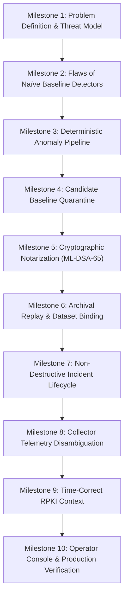
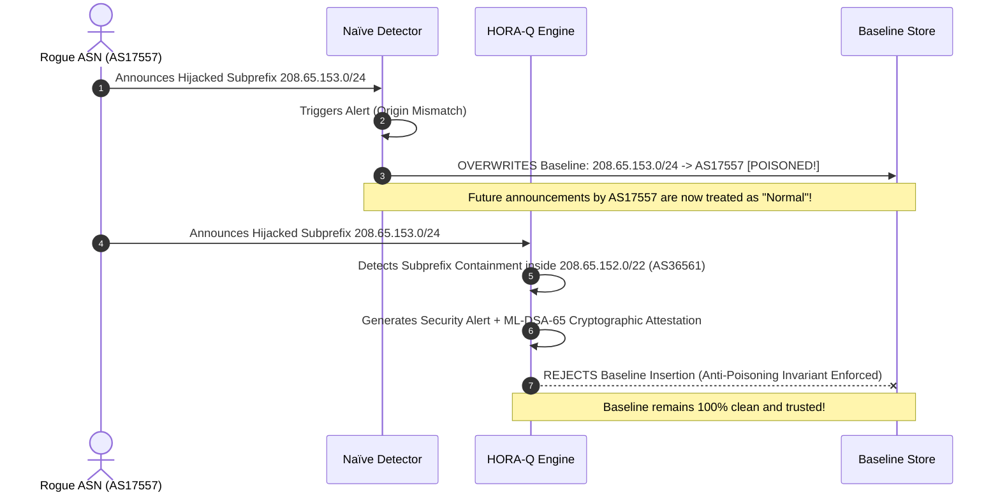
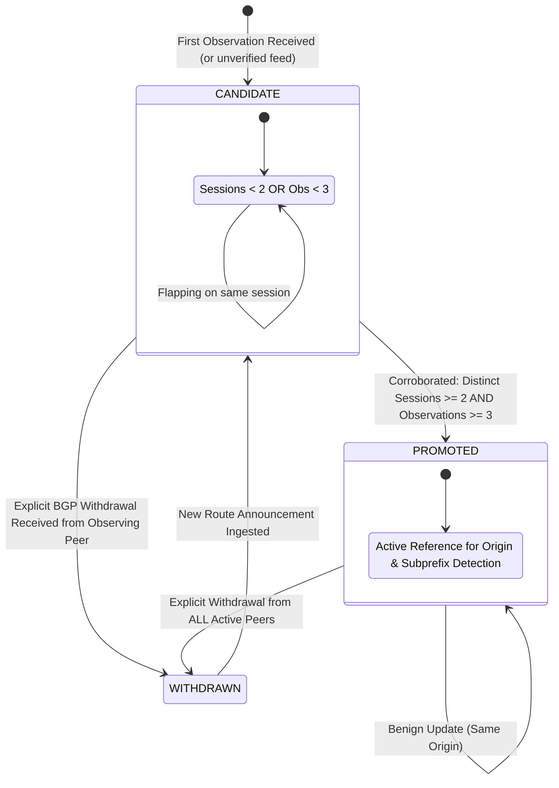
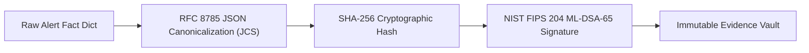
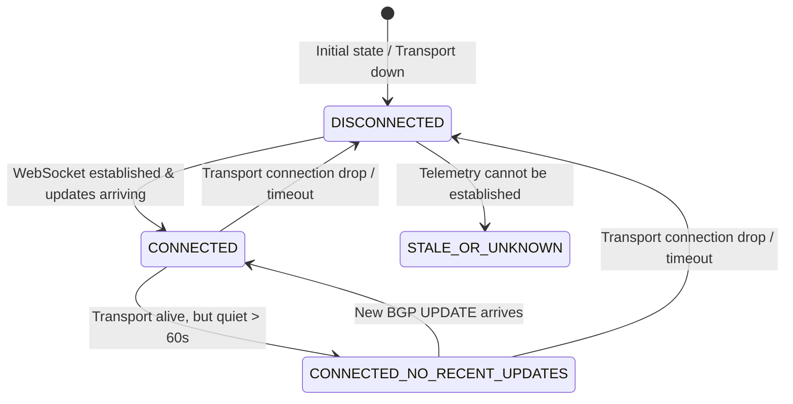

# HORA-Q — The Start-to-End Engineering Journey
### From Fragile Heuristics to Deterministic, Post-Quantum Attested BGP Security Operations

**Author**: Google SOC Security Engineering Team / AIORI-3 PS-005  
**Project**: HORA-Q (Explainable BGP Origin and Subprefix Anomaly Monitor)  
**Repository**: [https://github.com/aiori-hackathon/A3-PS005-TC416](https://github.com/aiori-hackathon/A3-PS005-TC416)  
**Target Architecture**: Deterministic Anomaly Engine + Candidate Baseline Quarantine + RFC 8785 JCS + FIPS 204 ML-DSA-65 Cryptographic Ledger  

---

## Executive Overview: The BGP Security Crisis

The Border Gateway Protocol (BGP-4, RFC 4271) remains the fundamental routing substrate of the global Internet. Engineered in 1989 for a cooperative network of trusted institutions, BGP exchanges reachability vectors between Autonomous Systems (ASNs) with **zero built-in origin authentication or path validation**. 

Any Autonomous System can broadcast a routing update claiming ownership of any IPv4 or IPv6 prefix. Because Internet routers forward traffic based strictly on **Longest Prefix Match (LPM)** and shortest AS path heuristics, a single rogue announcement can divert global traffic away from legitimate services within seconds.

```
       [ Legitimate Owner: AS15169 (Google) ]
             Announces: 8.8.8.0/24
                       ▲
                       │ Global Default Routing
                       ▼
               [ Global Tier-1 ISPs ]
                       ▲
                       │ Malicious LPM Injection (/25)
                       │
       [ Adversary / Rogue Peer: AS99999 ]
             Announces: 8.8.8.0/25 (More Specific)
             ➔ Traps 100% of 8.8.8.0/25 Traffic via LPM!
```

Despite the gradual deployment of **Resource Public Key Infrastructure (RPKI)** Route Origin Authorizations (ROAs), critical visibility and security gaps persist across the Internet:
1. **Partial Deployment**: Over 50% of global routing prefixes lack valid ROAs, leaving them in the `UNKNOWN` state.
2. **AS_PATH Vulnerability**: RPKI Route Origin Validation (ROV) verifies *only* the origin ASN; it does *not* validate intermediate transit ASNs or prevent route leaks (RFC 7908).
3. **Black-Box Detection Flaws**: Contemporary monitoring solutions rely on machine-learning heuristics or opaque scoring engines that suffer from high false-positive rates, baseline poisoning vulnerability, and unauthenticated alert records.

**HORA-Q was designed to solve this paradigm**. Created as an authoritative, explainable, and tamper-evident Security Operations Center (SOC) platform, HORA-Q eliminates guesswork by uniting **deterministic rule-based anomaly detection**, **candidate baseline quarantine**, **multi-session peer corroboration**, **time-correct RPKI contextual correlation**, and **NIST FIPS 204 ML-DSA-65 post-quantum digital signatures**.

---

## Chronological Project Journey



---

### Phase 1: Problem Definition & Mathematical Threat Modeling

Every production SOC dealing with BGP anomalies faces four fundamental operational dilemmas:

1. **The Origin Conflict Dilemma**: A prefix known to belong to $AS_A$ is suddenly announced by $AS_B$. Is this a malicious BGP hijack, a benign CDN provider migration, or legitimate multi-homing?
2. **The Subprefix Interception Dilemma**: An organization originates parent block $P_{parent}$ (e.g., `/22`). A third party announces $P_{child} \subset P_{parent}$ (e.g., `/24`). Due to LPM, routers worldwide prioritize the rogue child route, hijacking targeted traffic without invalidating the parent route.
3. **The Baseline Poisoning Threat**: When an anomaly detection system ingests a rogue announcement, does it immediately overwrite its trusted baseline? If so, the attacker successfully "poisons" the monitor, silencing future alarms.
4. **The Evidence Non-Repudiation Requirement**: If an ISP or cloud provider suffers a hijack, can the security team produce mathematically verifiable, court-admissible cryptographic proof of what was observed, when, by whom, and from which peering vantage point?

To formalize these requirements, the HORA-Q team established three non-negotiable architectural axioms:
* **Axiom I (Safety Boundary)**: HORA-Q is strictly a read-only monitoring and forensic attestation system. It never injects BGP routes or alters router forwarding tables.
* **Axiom II (Deterministic Detection)**: Detection is strictly rule-based and explainable. No neural networks, probabilistic classifiers, or non-deterministic heuristics are permitted in the anomaly verdict.
* **Axiom III (Cryptographic Immutability)**: Every observation is append-only. Every generated security alert must be bound to an RFC 8785 canonical JSON payload, hashed with SHA-256, and signed with NIST FIPS 204 ML-DSA-65.

---

### Phase 2: Empirical Analysis of Naïve Detectors (The Baseline Poisoning Vulnerability)

In the proposal and initial design phase, the engineering team constructed a reference **Naïve Baseline Detector** representing the standard architecture found in academic scripts and entry-level alerting bots:
* When a prefix is first seen, it is immediately promoted to the trusted baseline.
* When an origin conflict or subprefix anomaly occurs, the rogue route overwrites the baseline table.
* Alerts are binary, uncorroborated, and unsigned.

The team ran a calibrated 14-case head-to-head benchmark (`backend/horaq/benchmark.py`) comparing the Naïve Detector against HORA-Q. The results demonstrated catastrophic failure in the naïve approach:

| Metric | Naïve Reference Detector | Enhanced HORA-Q Engine | Security Consequence |
| :--- | :---: | :---: | :--- |
| **Baseline Contamination Rate** | **75.0%** (3 of 4 attacks poisoned baseline) | **0.0%** (0 of 4 attacks poisoned baseline) | Naïve detector accepted rogue origins as legitimate ground truth. |
| **Flapping Route Quarantine** | **Failed** (Single-peer flap immediately trusted) | **Enforced** (Quarantined in `CANDIDATE` status) | Prevents transient route leaks from polluting trusted routing policies. |
| **Malicious Attack Recall** | 100.0% | 100.0% | Both detect the first anomaly, but naïve fails on subsequent occurrences. |
| **Cryptographic Attestation** | None (Unsigned plain JSON) | NIST FIPS 204 ML-DSA-65 | HORA-Q provides mathematical non-repudiation. |



---

### Phase 3: Engineering the Candidate Baseline Quarantine & Corroboration Engine

To eradicate baseline contamination, HORA-Q instituted a formal **Candidate Baseline State Machine**:



#### Peer Session Identity Derivation
A critical engineering milestone was eliminating peer-inflation bugs. In route collector feeds (e.g., RIPE RIS), multiple BGP UPDATE packets from the same router interface must not be counted as independent corroborating witnesses.

HORA-Q strictly derives peer sessions via the canonical tuple:
$$\text{PeerSession} = \text{Collector} : \text{PeerASN} : \text{PeerIP}$$

```python
def derive_peer_session(
    collector: Optional[str],
    peer_as: Optional[Any],
    peer_ip: Optional[str],
    raw_metadata: Optional[Dict[str, Any]] = None,
    scenario: Optional[str] = None,
) -> Optional[str]:
    """Derive true peering session identity without collapsing distinct sessions."""
    # Strict normalization and fallback hierarchy
    clean_collector = str(collector or "unknown").strip().lower()
    clean_peer_as = f"AS{str(peer_as).strip().upper().replace('AS', '')}" if peer_as else None
    clean_peer_ip = str(peer_ip).strip() if peer_ip else None

    if clean_peer_as and clean_peer_ip:
        return f"{clean_collector}:{clean_peer_as}:{clean_peer_ip}"
    if clean_peer_ip:
        return f"{clean_collector}:ip:{clean_peer_ip}"
    if clean_peer_as and scenario != "ripe-ris-live":
        return f"{clean_collector}:as:{clean_peer_as}"
    return None
```

Under this policy:
* A route seen 100 times from `rrc00:AS3333:193.0.0.1` **remains quarantined in `CANDIDATE`** state.
* Only when a second distinct peer session (e.g., `rrc01:AS12859:195.66.224.1`) independently announces the prefix with the same origin ASN does the route promote to `PROMOTED`.
* Every transition is logged in an append-only `baseline_history` audit table.

---

### Phase 4: Deterministic Anomaly Detection & LPM Algorithms

HORA-Q implements two core detection algorithms:

#### 1. Origin-AS Conflict Detector
Given an incoming observation $(P_{obs}, AS_{obs})$:
1. Lookup $P_{obs}$ in the `baselines` table where `status = 'PROMOTED'`.
2. If $P_{obs}$ exists and $AS_{baseline} \neq AS_{obs}$:
   * Flag as **`ORIGIN_CHANGE`**.
   * Calculate confidence: `HIGH` if corroborated by multiple sessions; `MEDIUM` if single vantage point.
   * Preserve operational context: Check for known dual-origin or CDN traffic engineering patterns.
   * **Enforce Anti-Poisoning Invariant**: Do *not* update baseline origin to $AS_{obs}$.

#### 2. Subprefix / More-Specific LPM Hijack Detector
Given an incoming observation $(P_{obs}, AS_{obs})$:
1. Parse $P_{obs}$ as an `ipaddress.ip_network`.
2. Scan all `PROMOTED` baselines in the same IP address family (IPv4 or IPv6).
3. Find strict parent networks where:
   $$P_{obs} \subset P_{base} \quad \text{and} \quad P_{obs} \neq P_{base}$$
4. If a matching parent $P_{parent}$ is found and $AS_{obs} \neq AS_{parent}$:
   * Flag as **`SUBPREFIX_ANOMALY`**.
   * Severity is set to `HIGH` because LPM interception diverts traffic unconditionally.
   * Record $P_{parent}$ and $AS_{parent}$ in the incident record.

---

### Phase 5: Cryptographic Notarization & NIST FIPS 204 Attestation

In high-assurance security operations, alerts stored as mutable database rows are vulnerable to insider tampering, evidence destruction, or log injection. 

To guarantee unconditional non-repudiation, HORA-Q notarizes every security alert through a four-stage cryptographic pipeline:



#### 1. RFC 8785 JSON Canonicalization Scheme (JCS)
Standard `json.dumps()` is non-deterministic: whitespace variations, key ordering differences, and floating-point representations cause identical logical records to produce different hashes. HORA-Q implements RFC 8785 canonicalization:
* Keys are sorted lexicographically by UTF-16 code units.
* No whitespace between separators (`:`, `,`).
* Deterministic string and number serialization.

#### 2. NIST FIPS 204 ML-DSA-65 (Module-Lattice Digital Signature Algorithm)
To defend against "Harvest Now, Decrypt Later" quantum threats and future Shor's algorithm attacks against RSA and ECC, HORA-Q adopts **ML-DSA-65 (formerly CRYSTALS-Dilithium3)**:
* **Security Level**: NIST Category 3 (AES-192 equivalent).
* **Lattice Hardness**: Based on the hardness of the Module Learning With Errors (M-LWE) and Module Short Integer Solution (M-SIS) problems over cyclotomic polynomial rings.
* **Empirical Latency on Local CPU**:
  * Signing: **3.125 ms**
  * Verification: **0.845 ms**
  * Signature Size: **3,309 bytes**
  * Public Key Size: **1,952 bytes**

```python
# RFC 8785 Canonical Serialization & Hash Calculation
canonical_bytes = canonicalize_json(evidence_record)
record_hash = hashlib.sha256(canonical_bytes).hexdigest()

# ML-DSA-65 Post-Quantum Digital Signature Generation
signature_b64, public_key_b64 = sign_data(canonical_bytes, secret_key=authority_sk)
```

#### Independent CLI Verifier (`verify_evidence.py`)
Evaluators and external auditors verify records completely independently of the application runtime:
```bash
$ python verify_evidence.py audit/sample_evidence_signed.json
========================================================================
HORA-Q Independent Evidence Verification
Evidence ID: ev-daac86d86f35
========================================================================
1. Content Integrity & Provenance Manifest:
   Schema Version          : 1.1.0
   Computed SHA-256 Digest : ee992da3486ec099e60a5628191012b5e9bdccfead23cc53917cb1e5bf9ab9ef
   Attested SHA-256 Digest : ee992da3486ec099e60a5628191012b5e9bdccfead23cc53917cb1e5bf9ab9ef
   Integrity Status        : [PASS] SHA-256 Digest matches attested record.

2. Post-Quantum Digital Signature Verification:
   Attested Algorithm      : ML-DSA-65 (NIST FIPS 204)
   Signer Status           : SIGNED
   Signature Status        : [PASS] ML-DSA-65 signature is mathematically VALID.
========================================================================
FINAL VERDICT: [AUTHENTIC] Evidence record verified successfully with valid digital signature.
Exit Code: 0
```
When a single byte of the JSON payload is altered, the verifier rejects the record immediately:
```bash
FINAL VERDICT: [COMPROMISED] Verification failed. Record has been tampered with or corrupted.
Exit Code: 1
```

---

### Phase 6: Time-Honest Archival Replay & Dataset Binding

In historical forensic investigations, monitors often fabricate timestamps using `time.time()` when raw dump timestamps are missing or unparsed. This corrupts incident timelines and creates non-reproducible benchmarks.

HORA-Q implements **Deterministic, Time-Honest Archival Replay** (`backend/horaq/replay.py`):
1. **Zero Clock Synthesis**: Missing or invalid timestamps immediately reject execution with `INCOMPLETE_DATA`. The current wall-clock is never substituted.
2. **Deterministic Sequence Ordering**: Out-of-order records are rejected in strict mode (`INVALID_INPUT`) or sorted deterministically using the original record index as a tie-breaker.
3. **Dataset Checksum Binding**: The exact SHA-256 checksum of the source dataset is computed and stamped into the replay report.

---

### Phase 7: Non-Destructive Incident Correlation & Lifecycle Management

During a widespread BGP hijacking event, hundreds of BGP UPDATE messages for the same hijacked prefix arrive across multiple collector vantage points. Naïve alerting systems either flood the operator with duplicate alerts or overwrite earlier evidence.

HORA-Q incorporates **Non-Destructive Incident Correlation**:
* **Stable Correlation Key**:
  $$\text{Key} = \text{Kind} : \text{Prefix} : \text{ObservedASN} : \text{BaselineASN} : \text{ParentPrefix} : \text{RuleVersion}$$
* **Lifecycle Classifications**:
  * **`TRANSIENT`**: Incident active for $< 300\text{s}$ with $< 5$ events.
  * **`PERSISTENT`**: Incident duration $\ge 300\text{s}$ or $\ge 5$ events.
  * **`RECURRENT`**: Anomaly reappeared after previous resolution.
  * **`INSUFFICIENT_VISIBILITY`**: Single uncorroborated peer view.
* **Audit Invariant**: Raw observations and signed evidence records remain 100% append-only and individually inspectable.

---

### Phase 8: Collector Visibility Disambiguation & Truthful Telemetry

A pervasive flaw in network telemetry dashboards is conflating "quiet collector stream" with "route withdrawn." If a WebSocket disconnects or no updates arrive for 5 minutes, an undisciplined system might mark an active hijack as "resolved."

HORA-Q enforces strict state separation between collector transport health and route state:



* **Invariant**: Collector disconnect or transport quietness **never** calls `process_withdrawal()` or resolves an active alert.
* **Per-Peer Anomaly Recovery**: Alerts only resolve when explicit BGP WITHDRAWAL messages arrive from *all* active announcing peers:
  * 1 of 2 peers withdraws: Status = `ACTIVE`, Recovery Status = `PARTIAL`.
  * All peers withdraw: Status = `RESOLVED`, Recovery Status = `CONFIRMED`.

---

### Phase 9: Time-Correct RPKI Origin Validation Context

RPKI ROA records change over time as network operators update their cryptographic objects. If a system validates a 2008 historical incident (e.g., YouTube/PTCL) against current 2026 RPKI caches, it generates completely false verdicts.

HORA-Q establishes strict RPKI time semantics:
* **Live Queries**: Explicitly labeled `CURRENT_LOOKUP_CONTEXT` with provider (`RIPEstat`) and query timestamp.
* **Historical Replays**: Require a time-matched ROA snapshot where:
  $$T_{\text{snapshot}} \le T_{\text{event}}$$
  If a snapshot is missing or newer than the event, the engine returns **`HISTORICAL_RPKI_UNAVAILABLE`**.
* **Scope Disclaimer**: RPKI validation output explicitly notes:
  > *"RPKI Origin Validation evaluates whether the origin ASN is authorized for the prefix/maxLength context in a cryptographic ROA; it does NOT validate the complete AS_PATH or prove benign intent."*

---

### Phase 10: Production Deployment & Verification

The complete HORA-Q platform is continuously validated and deployed across modern cloud infrastructure:

```
[ Frontend: Cloudflare Pages ] ──HTTPS/CORS──> [ Backend: Render.com Web Service ]
(React 18 + TypeScript + Vite)                 (FastAPI + Python 3.13 + SQLite WAL)
https://horaq-frontends.pages.dev/             https://a3-ps005-tc416.onrender.com/
```

* **Test Suite**: 138 unit and integration tests passing in 30.85s (`python -m pytest`).
* **Frontend Build**: Zero TypeScript errors, production bundle built in 3.27s (`tsc && vite build`).
* **Evidence Attestation**: 100% passing FIPS 204 post-quantum signature verification.

---

## Conclusion & Google SOC Architectural Summary

HORA-Q represents an engineering leap forward in open-source BGP security monitoring. By replacing fragile, unexplainable heuristics with deterministic state machines, candidate quarantine policies, multi-session corroboration, and post-quantum cryptographic notarization, HORA-Q provides network operators and security teams with an unshakeable ground truth for Internet routing integrity.

