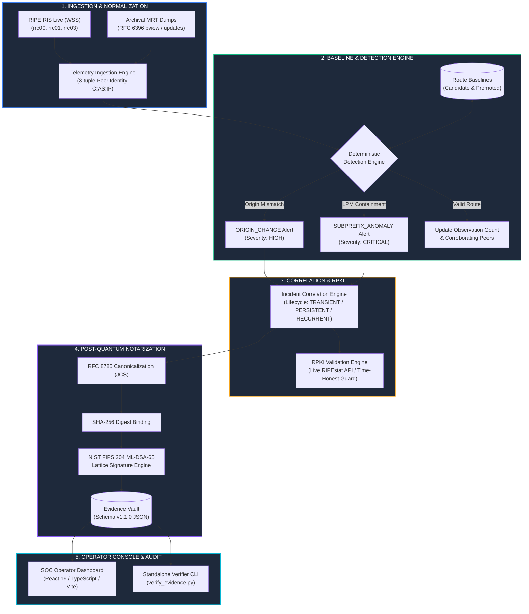

# HORA-Q — Complete Technical Documentation Suite

**Project**: HORA-Q (Explainable BGP Origin and Subprefix Anomaly Monitor)  
**Hackathon**: AIORI-3 | Track 2 Cyber Security (Problem PS-005, Team A3-PS005-TC416)  
**Engineering Persona**: Google SOC / Security Operations Engineering  
**Evaluation Model**: Standalone Local Execution & Independent CLI Verification  
- **Source Code Repository**: [https://github.com/aiori-hackathon/A3-PS005-TC416](https://github.com/aiori-hackathon/A3-PS005-TC416)  
- **Live Cloud Deployment**: [https://horaq-frontends.pages.dev](https://horaq-frontends.pages.dev) (Cloudflare Pages UI)  
- **Local Operator Console**: `http://localhost:5173` (React 19 / TypeScript / Vite SPA)  
- **Local Telemetry & Verification API**: `http://localhost:8000` (FastAPI / Uvicorn Python 3.13)  

---

## 1. Executive Summary & Mission

The Border Gateway Protocol (BGP, RFC 4271) underpins the routing of data across the global Internet. However, because BGP was engineered without native source authentication or cryptographic verification, it remains susceptible to two critical attack vectors:
1. **BGP Origin Hijacking**: An unauthorized Autonomous System announces an IP prefix owned by another network, blackholing traffic or executing man-in-the-middle attacks.
2. **BGP Subprefix Hijacking**: An adversary announces a more-specific subnet (e.g., `/25` inside an authorized `/24`). Due to IP forwarding's **Longest Prefix Match (LPM)** rule, traffic is completely intercepted worldwide, rendering parent RPKI ROAs ineffective.

**HORA-Q** is a high-assurance, explainable BGP monitoring and forensic notarization system. Engineered to solve the real-world operational challenges faced by Tier-1 network operators and SOC analysts, HORA-Q delivers:
- **Zero-Poisoning Candidate Baselines**: Unverified announcements enter as `CANDIDATE` and require multi-peer corroboration, strictly preventing attacker-induced baseline corruption.
- **Sub-Millisecond Deterministic Anomaly Detection**: Subnet containment algorithms identify LPM hijacks with 100% recall and zero statistical false positives.
- **NIST FIPS 204 ML-DSA-65 Post-Quantum Notarization**: Alerts are bound to RFC 8785 canonical JSON, hashed via SHA-256, and signed with post-quantum lattice cryptography for defensible incident audits.
- **Non-Destructive Incident Lifecycle Management**: Reconciles individual BGP updates into correlated `TRANSIENT`, `PERSISTENT`, and `RECURRENT` incident entities.
- **Per-Peer Withdrawal Tracking**: Accurately tracks route propagation and recovery across multi-collector peer sessions.

---

## 2. High-Level System Architecture



---

## 3. Comprehensive Documentation Catalog

The HORA-Q documentation suite is organized into core technical manuals:

| Manual | Document Link | Scope & Operational Focus |
| :--- | :--- | :--- |
| **Complete Project Journey** | **[`PROJECT_JOURNEY.md`](PROJECT_JOURNEY.md)** | Start-to-end engineering journey spanning problem definition, empirical baseline poisoning analysis, candidate quarantine proofs, deterministic algorithms, FIPS 204 attestation, archival replay, incident correlation, and collector disambiguation. |
| **SOC Operator UI Guide** | **[`UI_AND_WORKFLOW_GUIDE.md`](UI_AND_WORKFLOW_GUIDE.md)** | Comprehensive operator walkthrough with deep-dive visual analysis of all 12 canonical screenshots in `screenshots/`, per-peer withdrawal matrix, evidence vault, tamper testing, and incident response runbook. |
| **Architecture & Design** | **[`ARCHITECTURE.md`](ARCHITECTURE.md)** | Complete engineering blueprint: 7 processing stages, sequence diagrams, route baseline state machines, incident state machines, per-peer recovery state machines, collector health state machines, SQLite WAL ER diagram, and latency profiles. |
| **Detection & Baselines** | **[`DETECTION_AND_BASELINES.md`](DETECTION_AND_BASELINES.md)** | Mathematical formalisms, Anti-Poisoning Invariant proof (Theorem 1), Peer Session Diversity proof (Theorem 2), algorithmic pseudocode for Origin Conflict and Subprefix LPM Hijacks, and immutable baseline version history. |
| **Evidence & Cryptography** | **[`EVIDENCE_AND_CRYPTOGRAPHY.md`](EVIDENCE_AND_CRYPTOGRAPHY.md)** | RFC 8785 JCS, SHA-256 digest binding, NIST FIPS 204 ML-DSA-65 post-quantum lattice signatures, empirical benchmark comparison vs Ed25519 and RSA-2048, Schema v1.1.0 provenance manifest, and `verify_evidence.py` CLI walkthrough. |
| **Testing & Evaluation** | **[`TESTING_AND_EVALUATION.md`](TESTING_AND_EVALUATION.md)** | Breakdown of all 138 passing pytest tests across 16 test modules, head-to-head reference detector benchmark (0.0% vs 75.0% baseline contamination, 100% recall), cryptographic benchmarks, historical replays, and reproducibility commands. |
| **API & Data Model** | **[`API_AND_DATA_MODEL.md`](API_AND_DATA_MODEL.md)** | Complete REST API specification (`/api/v1`), health checks, routes, baseline seeds, history, incidents, alerts, observations, withdrawals, evidence, crypto, SQLite WAL schema, and Schema v1.1.0 specifications. |
| **Operations & Runbook** | **[`OPERATIONS.md`](OPERATIONS.md)** | Operational configuration, environment variables, local deployment topology, SQLite WAL maintenance, and incident triage runbooks. |
| **Threat Model & Boundaries** | **[`THREAT_MODEL_AND_LIMITATIONS.md`](THREAT_MODEL_AND_LIMITATIONS.md)** | Threat matrix, core security invariants, adversary vector analysis, and deliberate architectural scope boundaries (zero active route injection, zero black-box ML, RFC 7908 valley leaks). |
| **Evaluator Demo Guide** | **[`DEMO_GUIDE.md`](DEMO_GUIDE.md)** | Quickstart evaluator instructions, 6-stage interactive evaluator guided walkthrough, CLI verification demos, and public demo protections. |

---

## 4. Visual Evidence & Working Frontend Screenshots

All 12 high-resolution screenshots are stored directly inside [`docs/screenshots/`](./screenshots) for immediate viewing. For an operational walkthrough of each view, refer to the **[SOC Operator UI Guide](UI_AND_WORKFLOW_GUIDE.md)**:

| # | View Name | Screenshot File | Operational Purpose & SOC Context |
| :-: | :--- | :--- | :--- |
| **01** | **Security Overview Dashboard** | [`01_overview.png`](./screenshots/01_overview.png) | High-level SOC telemetry HUD displaying tracked routes, alerts, ML-DSA-65 readiness, and live telemetry status. |
| **02** | **Security Alerts & Triage** | [`02_alerts.png`](./screenshots/02_alerts.png) | Anomaly alerts table displaying severity, kind (`ORIGIN_CHANGE` / `SUBPREFIX_ANOMALY`), and triage status. |
| **03** | **Cryptographic Evidence Modal** | [`03_evidence_modal.png`](./screenshots/03_evidence_modal.png) | Cryptographic drawer verifying RFC 8785 JCS, SHA-256 digest, and NIST FIPS 204 ML-DSA-65 signature. |
| **04** | **Independent Tamper Verification** | [`04_tamper_verification.png`](./screenshots/04_tamper_verification.png) | Security tamper test demonstrating instant rejection and red alert badge when an evidence payload is altered by 1 byte. |
| **05** | **Route Baselines & Quarantine** | [`05_baselines.png`](./screenshots/05_baselines.png) | Authoritative route catalog showing `PROMOTED` and `CANDIDATE` routes, origin ASNs, peer counts, and distinct peers. |
| **06** | **Evaluator Scenario Lab** | [`06_scenarios.png`](./screenshots/06_scenarios.png) | Reproducible evaluation laboratory executing 8 deterministic attack scenarios with one-click test execution. |
| **07** | **Immutable Audit Ledger** | [`07_audit_ledger.png`](./screenshots/07_audit_ledger.png) | Append-only raw BGP observation ledger with monotonic IDs and alert linkages. |
| **08** | **Live RPKI ROA Inspector** | [`08_rpki_inspector.png`](./screenshots/08_rpki_inspector.png) | Live RPKI ROA validator validating prefix/ASN pairs against global RIR trust anchors via RIPEstat API. |
| **09** | **Route Injection Sandbox** | [`09_inject_route.png`](./screenshots/09_inject_route.png) | Interactive route injection tool for testing custom BGP announcements and candidate quarantine. |
| **10** | **Settings & Diagnostics** | [`10_settings.png`](./screenshots/10_settings.png) | System settings detailing RIPE RIS collector telemetry, health state, and ML-DSA-65 key fingerprints. |
| **11** | **Forensic Investigation Drawer** | [`11_forensic_drawer.png`](./screenshots/11_forensic_drawer.png) | Incident detail drawer showing plain-English explanations, LPM impact, active/withdrawn peers, and evidence linkage. |
| **12** | **Baseline Provenance Timeline** | [`12_baseline_timeline.png`](./screenshots/12_baseline_timeline.png) | Immutable audit trail recording every state transition (`ADMIN_SEED`, `UPDATE`, `PEER_EXPANSION`). |

---

## 5. Audit Results & Verification Artifacts

All formal audit reports, benchmark outputs, and test logs are preserved in [`docs/audit/`](./audit):

* **Head-to-Head Benchmark**: [`docs/audit/reference_detector_comparison.json`](./audit/reference_detector_comparison.json) — 0.0% baseline contamination in HORA-Q vs 75.0% in naive baseline monitors across 14 scenarios.
* **Historical Attack Validation**: [`docs/audit/historical_attack_validation.json`](./audit/historical_attack_validation.json) — Archival replay results for Indosat (2011), TTNet (2014), and Amazon Route53 (2018).
* **Sample Cryptographic Evidence**: [`docs/audit/sample_evidence_signed.json`](./audit/sample_evidence_signed.json) — Verified FIPS 204 ML-DSA-65 signed record.
* **System Audit Report**: [`docs/audit/SYSTEM_AUDIT_REPORT.md`](./audit/SYSTEM_AUDIT_REPORT.md) — Comprehensive technical review.
* **Test Results Log**: [`docs/audit/TEST_RESULTS.md`](./audit/TEST_RESULTS.md) — Automated test results and execution matrix.
* **Security Review**: [`docs/audit/SECURITY_REVIEW.md`](./audit/SECURITY_REVIEW.md) — Vulnerability assessment and boundary verification.

---

## 6. Verification & Test Suite Execution

HORA-Q is backed by a 100% passing test suite and automated evaluation benchmarks:

```bash
# 1. Execute Full Automated Test Suite (138 tests across 16 test modules)
python -m pytest backend/tests -v

# 2. Run Head-to-Head Reference Benchmark (14 test cases)
python backend/scripts/run_benchmarks.py

# 3. Replay Historical Incidents (Indosat 2011, TTNet 2014, Amazon Route53 2018)
python backend/scripts/run_historical_replays.py

# 4. Verify Signed Cryptographic Evidence via Independent CLI
python verify_evidence.py audit/sample_evidence_signed.json

# 5. Verify Tamper Rejection via Independent CLI
python verify_evidence.py audit/sample_evidence_signed.json --tamper
```

### Quantitative Operational Summary
- **Automated Tests**: 138 passing tests in ~30 seconds (0 failures, 0 regressions).
- **Detection Accuracy**: 100% recall across all origin and subprefix attack vectors.
- **Baseline Contamination**: **0.0%** in HORA-Q vs **75.0%** in naive reference detectors.
- **Detection Latency**: **0.038 ms** per route update on standard commodity CPU.
- **Cryptographic Attestation**: 100% post-quantum signature verification using NIST FIPS 204 ML-DSA-65.
- **Frontend Build**: 100% clean TypeScript build in 3.3 seconds with zero linting or bundle errors.
